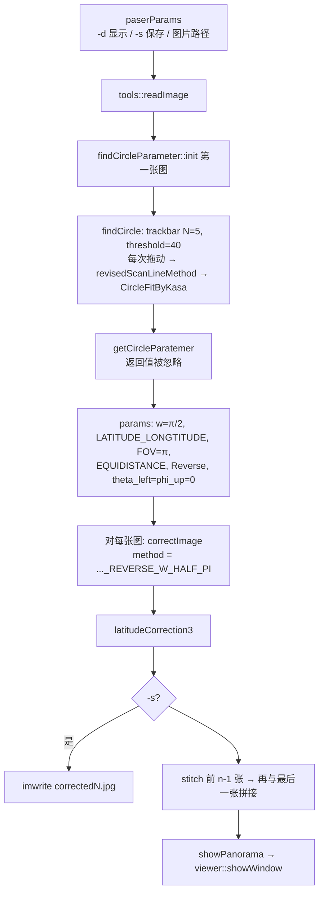
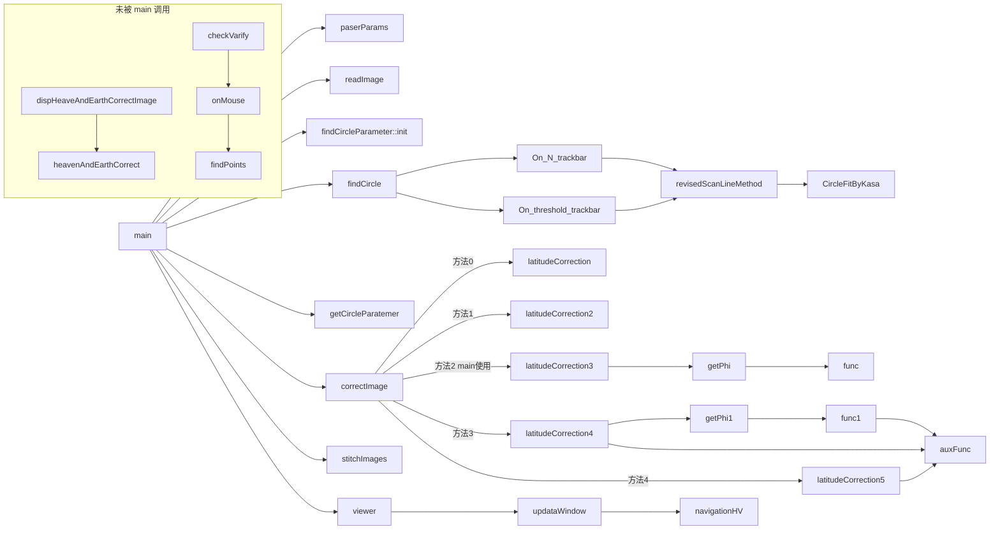

# Fish-eye Image Correction：源码、数学原理与 LCCP 复现研究报告

> 研究对象：`wangzhizhou/Fish-eye-Image-Correction-Code`，HEAD `d6202d9bbfe344f0ecd74096c744a7f091402952`（master）
> 研究日期：2026-11-11
> 本报告中的每条结论都标注了依据类型：**[源码]** 有文件/行号；**[论文]** 来自仓库内 `Paper/单幅圆形鱼眼图像的校正.pdf` 原文（页码/公式号）；**[推导]** 本文推导，且列出验证方式；**[实验]** 有可复现的脚本与指标文件。
> 行号均指 `program/` 下对应文件。
> **第二阶段更新（2026-11-11）**：新增 **[C++]** 依据类型——原始 `program/` 源码（未修改）用 Homebrew OpenCV 4.14.0 + Apple clang 21 编译，经非交互测试驱动 `research/cpp_harness/` 实测（§10.6）。新增 **[学位论文]** 依据类型——`Paper/鱼眼成像全景漫游系统的研究.docx`（按章节标注）。C++ 实测**推翻**了第一阶段的一个假设：`cv::Point(u,v)` 是**截断**而非四舍五入（§10.6.2）；受影响的数值（§0、§8.2、§10.5、BUG-05）已改正，旧值保留并标注。

---

## 0. 结论摘要

| # | 结论 | 依据 |
|---|---|---|
| 1 | `main.cpp` 实际运行的是 **Correction3**（`latitudeCorrection3`，ω=π/2），不是论文 Eq.17 所描述的映射：Correction3 对**经度也做了** Braun 压缩，而论文是 u(λ)=λ 线性。与论文一致的是 Correction4。 | [源码] main.cpp L98, corrector.cpp L615-617；[论文] Eq.17 |
| 2 | `auxFunc(w,φ)` 的闭式解：`sgn(ψ)·2 sin w · sin(|ψ|/2) / sin(w+|ψ|/2)`，ψ=π/2−φ 为地理纬度；h(w)=2 sin w/(sin w+cos w)=√2 sin w/sin(3π/4−w)（与论文 Eq.17 完全一致）；合法域 w∈(0,3π/4)。 | [推导]+SymPy 33/33、数值 ≤8e-15 |
| 3 | LCCP 等价于：在子午面内，以切点 C 处的切线（圆柱母线）为像平面，北半球从**固定点 X=(cos2ω, sin2ω)** 做中心投影，南半球从其镜像点投影。ω=π/2 时 X 为 C 的对径点，即 **Braun 球极柱面投影** y=2tan(ψ/2)。 | [推导]，数值验证 ≤3e-14（tests/test_lccp.py） |
| 4 | `getPhi(l)` 的闭式解为 `2·atan(l/(4−l))`；但 `func` 对**任意 l** 都有一个伪根 φ=π/2，l→2 时两根合并成二重根。源码的停止条件是 \|f\|≤1e-4（作用在函数值上），导致**赤道附近 φ 误差达 0.0123 rad（0.70°）**，在 1920×1920 输出中约 3.7 行/列，原图上约 4.9 px，表现为中心十字区域的"马赛克"块。 | [推导]+SymPy；[实验] B2、E1、E2 |
| 5 | 上述 getPhi 伪影**确实存在于原 C++ 程序的输出中**。更强的证据：编译后的原始代码以圆参数 **(946,634,623)** 处理 `ImagesForTest/1/1–4.JPG`，按 main.cpp 的 `imwrite` 写出的 JPEG 与仓库 `resources/corrected0–3.jpg` **逐字节完全相同**（4/4）。在同一采样方式下，赤道行 950–970 与"源码 getPhi"的 MAE 为 1.10，与"闭式解 φ"的 MAE 为 8.29。 | [C++] §10.6.1；[实验] metrics/cpp_harness.json |
| 6 | Correction4（反向）与 Correction5（正向）在 **EQUIDISTANCE** 下**数学上互逆**：连续往返误差 6.3e-12 px；源码数值（二分+fastAtan2）引入 ≤0.25 px。**整数像素管线**：C5 截断输出坐标，C4 的 `Point(u,v)` **也截断**鱼眼坐标（C++ 实测，第一阶段误作四舍五入），Python 随机点实验：平均 2.69 px，偏置 **(−1.44, −2.00)** px；C++ 坐标编码图实测：平均 3.33 px，偏置 (−1.61, −2.63) px（第一阶段在错误假设下报告 2.07 px、(−0.93, −1.49)，已改正，§8.2）。其他三种镜头模型下**不互逆**（C++ 实测平均 17–83 px），因为 C5 在 L1159 写死了等距模型。 | [实验] D；[C++] §10.6.3 |
| 7 | `func1`/`getPhi1` 使用函数内 `static` 缓存 h(w)：同一进程中先用 w=π/2 再用 w=π/4，509/512 行纬度错误（最大 90°）。 | [源码] L1003/L1011；[实验] B3 |
| 8 | VALS 的"剔除距离 ≥ 均值的切点对"规则（论文原文规则，源码一致）在干净图像上反而保留了**较差**的切点对；N=3 时在无噪声合成图上只剩 1 对 → Kasa 失败。对噪声和圆外亮斑非常敏感（σ=8 噪声：中心误差 31–86 px；4 个亮斑：43–140 px）。 | [实验] E2 |
| 9 | 共整理 26 项源码问题（§12）。Python 移植上有自动化测试的 14 项（BUG-01–11、13、14、20）；**C++ 实测**覆盖 17 项。第一阶段只有代码审查依据的 6 项中，BUG-12、15、16、23、26 被确认；BUG-24 的坐标颠倒被确认无实际影响，360°×180° 假设仍未验证。 | §12，§10.6 |
| 10 | 原代码在 OpenCV **4.x 下可编译**（4.14.0 实测；4.10.0 头文件齐全），旧 C API 宏（CV_WINDOW_NORMAL、CV_BGR2GRAY、CV_SVD、cvFastArctan）由 `globalInclude.h` 引入的 `highgui_c.h` → `core_c.h`/`imgproc_c.h` 提供；这些头文件在 **OpenCV 5.x 中已删除**，因此在 5.x 下无法编译（BUG-26）。 | [C++] §10.6.4 |
| 11 | git 历史表明：期刊论文接收时（2015-05-08，`afff761`），main 调用的是 **Correction4 + Correction5**（ω=π/2）；main 改用 **Correction3**，是在 9 天后的重构 `2143053` 中。getPhi/C3 早在 2014-11-15 就已加入，C4/C5/getPhi1/auxFunc 加入于 2014-11-29。 | [源码/git] §2.7 |
| 12 | 学位论文第五章描述的拼接（SURF + 比值筛选 + 对称筛选 + RANSAC 单应 + ROI 加权融合，逐对拼接）**在项目源码的任何提交中都没有实现**；拼接代码从 `1b06e47`（2015-11-06）起一直调用 `cv::Stitcher`。浏览器的水平视场（d=300、窗口宽 1024 ⇒ 119.3°）与论文"120 度左右"一致。 | [学位论文] 第 5、6 章；[源码/git] |
| 13 | **改进实施（第三阶段，§16）**：在独立目录 `research/improved/` 实现了 §14 的全部建议，并与编译后的原始代码逐项对比。合成真值上，相同投影的 MAE 6.78 → **1.68**（PSNR 19.3 → 31.0 dB），赤道十字带 MAE 17.6 → 2.6；单线程 1920² 校正 ≈2 s → 50–70 ms；浏览器 ≈750–860 ms → ≈3 ms；在 OpenCV 4.14 与 5.1 下都能编译。**两项新的实测发现**：(a) 六组真实图像的旋转自标定一致表明，镜头更接近**等立体角模型、视场约 183°**，而不是代码/论文假设的等距 180°（2 px 内一致的匹配：57–83% vs 1–11%）；(b) 按形状形变度量，论文的 C4（经度线性）优于 main 实际使用的 C3，最优为 **经度线性 + LCCP ω≈1.81**。原始流水线（C3 + cv::Stitcher）在 6 组中只拼成 3 组，球面拼接 6/6。 | [实验] §16，metrics/improved.json |

---

## 1. 背景、目标与资料范围

**目标**：从源码出发建立单幅圆形鱼眼图像校正（VALS 圆域检测 + Kasa 拟合 + 镜头模型 + 经纬映射 / LCCP）的完整数学模型，用独立 Python 程序复现并以数值实验验证。

**使用的资料**

| 资料 | 状态 |
|---|---|
| `program/*.cpp/*.h`（12 个文件） | 全部逐行阅读 |
| `README.md`、`build.sh`、`run.sh`、`Dockerfile`、`.vscode/*`、`.gitmodules`、`ImagesForTest/valid_params.txt` | 已读 |
| `Paper/单幅圆形鱼眼图像的校正.pdf`（5 页，《计算机应用》2015,35(5):1444-1448） | **已获取原文**。PDF 无文本层（嵌入字体缺失），逐页渲染为图像后阅读。公式 (1)–(17)、表 1、图 1–7 均已核对 |
| `Paper/鱼眼成像全景漫游系统的研究.docx`（硕士学位论文） | **第二阶段已读**：用 zipfile 解析 `word/document.xml`，共 569 个段落、7 章，保留标题层级以便按章节引用。**局限**：正文中的公式是 165 个 MathType（Equation.DSMT4）OLE 对象，预览图为 WMF，本机无法渲染（sips 不支持 WMF，qlmanage 超时），因此**学位论文中的公式内容未核对**，只引用文字部分（§13.2） |
| `毕业答辩.pptx`、演示视频 | 未阅读 |
| git 历史 | **第二阶段已分析**：134 个提交（2014-08-28 – 2026-09-14），`git log --stat/--follow/-S`，旧提交中的 GBK 注释用 iconv 解码（§2.7） |
| C++ 编译运行 | **第二阶段已编译**：Homebrew `opencv@4` 4.14.0、Apple clang 21.0.0，编译选项与 build.sh 相同（`-std=c++11 -g`）。仓库 `opencv/` 子模块当前处于 5.1.0 且工作区文件被暂存删除（使用前就是这个状态，本研究未改动），因此**没有**运行 build.sh（它会 checkout 子模块）。测试驱动见 §10.6 |

---

## 2. 仓库结构与整体架构

### 2.1 目录

```
program/              全部 C++ 源码（约 2 000 行）
  main.cpp            入口：参数解析 → 圆域检测 → 校正 → 拼接 → 浏览
  globalInclude.h     PI、LIMIT=1e-4、枚举 CorrectType / camMode / distMapMode
  findCircleParameter VALS 变角度线扫描 + Kasa 圆拟合 + 交互验证（GUI trackbar）
  corrector           heavenAndEarthCorrect、latitudeCorrection1–5、func/getPhi/func1/getPhi1/auxFunc
  imagesStitcher      cv::Stitcher(PANORAMA) 封装
  viewer              全景浏览（把全景图当作 360×180 经纬图做透视重采样）
  tools               读图、提示
ImagesForTest/1..9, other   测试鱼眼图（1–6 每组 4 张 1920×1280）；valid_params.txt 给出各组可用 N、阈值
resources/            README 示例图：1–4.JPG（480×320 缩略图）、corrected0–3.jpg（1920×1920）、panorama.jpg、navigate.png
Paper/                期刊论文 PDF、学位论文 docx、答辩 pptx、演示视频
opencv/{main,contrib,extra}  OpenCV 子模块（build.sh 只用 main）
OrzCalibration/       空目录 + 指向不存在仓库的子模块（第二阶段已用脚本移除并暂存，待提交，见 §15.1）
```

### 2.2 核心模块职责

| 模块 | 职责 | 关键函数 |
|---|---|---|
| tools | 读入命令行给出的图片（`IMREAD_COLOR`，保证 3 通道） | `readImage`, `GetImages`, `Tip` |
| findCircleParameter | 交互式（N、阈值 trackbar）求圆心/半径 | `findCircle` → `On_*_trackbar` → `revisedScanLineMethod` → `CircleFitByKasa` |
| corrector | 鱼眼 → 球面 → 平面 | `correctImage` 分派到 `latitudeCorrection{,2,3,4,5}` |
| imagesStitcher | OpenCV 拼接 | `stitchImages` |
| viewer | 交互浏览全景 | `updataWindow`, `navigationHV`, `onMouse` |

### 2.3 主程序执行流程



### 2.4 函数调用关系



### 2.5 参数传递

`correctParameters`（corrector.h）在 main.cpp L80-89 填写，**所有图片共用第一张图的圆参数**。

| 字段 | main 中的值 | 被哪些方法使用 |
|---|---|---|
| center, radius | VALS 结果（int） | 全部 |
| w_longtitude | π/2 | C4/C5 接收，但**从未参与计算**（L855 计算后不用，L882 被注释） |
| w_latitude | π/2 | C4、C5 |
| distMap | LATITUDE_LONGTITUDE | C2–C5（C5 不看） |
| theta_left, phi_up | 0 | 仅 PERSPECTIVE 分支 |
| camerFieldAngle | `findCircleParameter::FOV = PI` | 全部 |
| camProjMode | EQUIDISTANCE | C2–C4（C5 写死等距） |
| typeOfCorrect | Reverse | **仅方法 0**（latitudeCorrection） |

实测：集合 1 四张图各自 VALS（N=5,t=23）的结果为 (946,634,623)、(944,635,625)、(948,636,625)、(951,635,621)，差异 2–7 px，与检测抖动同量级，因此"共用第一张图参数"是合理的设计选择。

### 2.6 实际使用的算法分支

`correctMethod` 枚举（corrector.h）与实现：

| 枚举 | 函数 | 纬度映射 | 经度映射 | 采样 |
|---|---|---|---|---|
| LONG_LAT_MAP_REVERSE_FORWARD | latitudeCorrection | 线性 | 线性 | 正交模型，正/反向 |
| PERSPECTIVE_LONG_LAT_MAP_CAMERA_LEN_MODEL | latitudeCorrection2 | 线性（经纬映射 / 等距柱面） | 线性 | 反向，4 种镜头 |
| **..._REVERSE_W_HALF_PI（main 使用）** | **latitudeCorrection3** | **Braun（getPhi）** | **Braun（getPhi）** | 反向 |
| ..._REVERSE_W_VARIABLE | latitudeCorrection4 | LCCP(w)（getPhi1） | 线性 | 反向，固定 512×512 |
| ..._FORWORD_W_VARIABLE | latitudeCorrection5 | LCCP(w)（auxFunc 正算） | 线性 | **正向**，固定 512×512，写死等距 |

### 2.7 git 历史：校正算法的演变（第二阶段新增）

方法：`git log --stat`、`git log --follow -- program/corrector.cpp program/findCircleParameter.cpp`、`git log --all -S<符号>`（定位符号首次出现和消失的提交）、`git show <提交>:<路径>`。2015 年前的源码注释为 GBK 编码，用 `iconv -f GBK` 解码后引用。共 134 个提交。文件路径变化：`Outline Extract/` →（`317676b`，2015-11-21）`navigator/` →（`ed6fea1`，2024-01-06）`program/`。

| 日期 | 提交 | 提交信息（原文） | 与校正算法相关的变化 [源码/git] |
|---|---|---|---|
| 2014-08-28 | `c00c1d8` | panoramaExpansion added | 天地展开（后来的 heavenAndEarthCorrect）的前身 |
| 2014-08-31 | `3558469` | revised scan-line method completed! | 出现 `CircleFitByKasa`、变角度线扫描 |
| 2014-09-15 | `758c51d` | added TrackBar for parameters | N/阈值 trackbar |
| 2014-11-11 | `9838ef9` | perspective map has been added | `latitudeCorrection.cpp` 中加入透视映射；首次出现 `imwrite("ret.jpg")` |
| **2014-11-15** | **`193dede`** | **to write the small paper** | **加入 `latitudeCorrection3`、`func`、`getPhi`**；main 调用 latitudeCorrection3。这里的 func/getPhi 函数体与 HEAD **逐行相同**（只差类名前缀和一处空格，用 diff 核对），BUG-01/02 从那时起一直存在。C3 中经纬度都调用 getPhi，也是从这次提交开始 |
| **2014-11-29** | **`784b759`** | **The final** | **加入 `latitudeCorrection4/5`、`func1`、`getPhi1`、`auxFunc`**，含 `static double limit/lim`（BUG-03）、C4/C5 的 `width = 512`、经度 getPhi1 的那一行一开始就是注释（BUG-18）。此时 C5 的行坐标仍是**线性**的 `v_latitude = (latitude - latitude_offset) / dy`，LCCP 式子是注释；main 调用 `latitudeCorrection5(..., PI/180*90, PI/180*90)`，旁边的注释（GBK 解码）写着"如何让两个方向的调整互不影响" |
| **2015-05-08** | **`afff761`** | **This commit finished when my paper is accepted by joca journal** | 论文被《计算机应用》（JOCA）接收当天：C5 行坐标**改为 LCCP** `v_latitude = l*imgSize.height/(2*limi_latitude)`（即论文 Eq.17）；main 改为调用 `latitudeCorrection4(..., π/2, π/2)`（输出 left.jpg）和 `latitudeCorrection5(..., π/2, π/2)`（forwardMap.jpg）。**这是唯一一个 main 使用与论文 Eq.17 一致的映射（经度线性）的版本** |
| 2015-05-16 | `f0182a9` | refine the image load and check FOV ... | `outlineExtract.cpp` → `findCircleParameter.cpp`；main 中的校正调用全部注释掉 |
| **2015-05-17** | **`2143053`** | **refined the partion of correction fish-eye image PS: so tired~~** | 把 `latitudeCorrection.cpp` 合并进 `corrector` 类，引入 `correctMethod` 枚举和 `correctImage` 分派；**main 改为 `..._REVERSE_W_HALF_PI`（Correction3）**，并一直沿用到 HEAD。提交信息没有说明为什么从 C4 换成 C3 |
| 2015-11-03 – 11-21 | `40e7d37`、`1b06e47`、`736a1b0`、`317676b` | 添加了初级全景视图浏览器 / 添加了图像拼接部分 / 程序暂停一段时间，开始全力写论文 / 重新调整了项目结构 | viewer、`imagesStitcher`（从一开始就是 `cv::Stitcher`）、`correctImage(..., isDispRet)` |
| 2017-08-20 | `7820bab` | update opencv to 3.3.0 + vs2017 | 只加了 `cv::` 前缀，没有改算法 |
| 2024-01-07 | `6e3251b`、`8968a31` | build and run success / 删除系统API调用，保持跨平台 | 源码转为 UTF-8；main 改用命令行参数——**main.cpp L52 的 `i <= imagePaths.size()`（BUG-12）在 `8968a31` 中引入** |
| 2024-01-07 | `ad049f4` | update readme images | 加入 1920×1920 的 `resources/corrected0–3.jpg`、`panorama.jpg`；当时 build.sh 为 **OpenCV 4.9.0**，run.sh 为 `./product/navigator ImagesForTest/1/*JPG` |
| 2024-08-28 | `bdc7079`、`f70cd93` | update opencv to 4.10.0 / add OrzCalibration app | OpenCV 4.10.0；加入 OrzCalibration 子模块 |

结论：
* **C3 是 C4 的前身**：先有固定 ω=π/2、经纬都用 Braun 的 C3（2014-11-15，"to write the small paper"），后有 ω 可变、经度线性的 C4/C5（2014-11-29）。论文 Eq.17 的形式（u=λ）与 C4/C5 对应。
* **"为什么最后用 C3"在 git 中没有记录**。`2143053` 的提交信息只写"refined the partion of correction"。学位论文 §4.2 承认"改进的方法在水平方向上的校正不理想，因为图中的车辆被明显拉长了"（见 §13.2），但无法从文本判断该图用的是 C3 还是 C4，**不作推断**。
* 2024 年的 `resources/corrected0–3.jpg` 由 OpenCV 4.9.0 构建的程序生成，用 OpenCV 4.14.0 的 C++ 重新生成后**逐字节相同**（§10.6.1），说明这些版本之间 C3 路径的数值和 JPEG 编码器输出都没有变化。

---

## 3. VALS 鱼眼圆域检测

### 3.1 算法（逐行对应 findCircleParameter.cpp L355-837）

1. **扫描角度**（L369）：n = 0…2N−1，θₙ = πn/(2N)。论文写作"倾斜角从 0 开始以 π/2n 递增"（论文示例 n=3，得到 0°,30°,…,150° 共 6 个方向，与表 1 一致）。
2. **四类扫描**：
   - n=0：逐行，从上往下、从下往上；
   - 0<n<N：直线 y = tanθ·(i−x) 从左上角推进（L444-497），y = H−1−tanθ·(x−i) 从右下角推进（L506-559）；
   - n=N：逐列，从左往右、从右往左；
   - N<n<2N：L643-756（左下 / 右上）。
3. **边缘判定**：
   - 水平/垂直方向：**单条扫描线**上 `max−min > threshold`（`minMaxLoc`），切点 = 该行（列）第一个最大值像素；
   - 斜向：`max1/min1` **在所有已扫描的线上累积**（不在每条线开始时重置），任一时刻累积 `max−min > threshold` 即触发，切点 = 达到累积最大值的那个像素。这与论文"同一扫描线上的像素最大亮度值与最小亮度值之差"的描述**不一致** [源码 vs 论文]。
4. **距离样本**：两侧都找到时记录两切点距离；只找到一侧则丢弃（L433-440 等）。
5. **异常过滤**（L794-811）：均值 mean，保留 `distance < mean`（严格小于）的点对。论文 p.1445：“剔除那些半径大于均值的切点对”——**规则与源码一致**。
6. **Kasa 拟合**（L815）。

### 3.2 阈值的作用

阈值决定"背景 → 圆域"的亮度跳变。阈值过低：背景噪声（累积 max−min 在很多像素上取到噪声的极差）提前触发；阈值过高：暗边（渐晕）不触发或在更内侧触发，半径偏小。真实图像上半径随阈值单调变小（§3.4）。

### 3.3 合成实验（实验 E2，**合成数据**，GT 圆心 (410.3, 297.6)，r=260，800×600）

源码复刻版 N=5、t=40，三个随机种子（metrics/vals_E2_synthetic_sweeps.csv）：

| 条件 | 源码 VALS 中心误差 (px) | 源码半径误差 | 改进版 VALS 中心误差 | 改进版半径误差 |
|---|---|---|---|---|
| 干净 | 0.67 / 0.67 / 0.67 | 1.0 | 0.03 / 0.01 / 0.00 | 0.10–0.12 |
| 噪声 σ=8 | 31.3 / 86.5 / 47.2 | 31–78 | 0.02–0.03 | 0.06–0.07 |
| 低对比度 + 渐晕 | 13.5 / 1.4 / 4.9 | 35–37 | 9.7–10.9 | 82–85（**更差**） |
| 边缘缺失 60° 扇区 | 0.50 | 1.0 | 0.01–0.04 | 0.12–0.13 |
| 圆外 4 个亮斑 | 42.7 / 139.7 / 93.8 | 43–55 | 0.00–0.03 | 0.10–0.12 |

* 干净图像的 0.67 px 误差下限 = (410.3, 297.6) 截断为 (410, 297) 的距离 √(0.3²+0.6²)=0.67 → **完全由 int 截断造成**（BUG-08）。
* N 扫描：干净图像 N=3 失败（只剩 1 对点，BUG-09）；所有条件 N=1 失败（只有水平+垂直 2 对，过滤后剩 1 对）。
* 阈值扫描：低对比度在 t≥80 时源码版失败（圆内外差不足 80）。
* 图：`results/figures/vals_E2_synthetic_sweeps.png`、`vals_E2_examples.png`。

### 3.4 真实图像（实验 E3，**无真值**，只能看稳定性）

每组第一张图，阈值 {10,20,30,40,60} ∪ valid_params.txt 中的阈值（metrics/vals_E3_real_stability.json）：

| 组 | 源码版：cx/cy/r 极差 (px) | 改进版：cx/cy/r 极差 (px) |
|---|---|---|
| 1 | 18 / 50 / 68 | 7.9 / 10.4 / 13.0 |
| 2 | 7 / 9 / 15 | 1.8 / 1.9 / 9.7 |
| 3 | 13 / 7 / 29 | 6.4 / 5.1 / 28.1 |
| 4 | 6 / 19 / 33 | 3.9 / 33.7 / 32.0 |
| 5 | 3 / 6 / 6 | 1.7 / 9.0 / 13.2 |
| 6 | 21 / 17 / 19 | 8.2 / 15.2 / 23.9 |

两种算法的半径都随阈值增大而单调变小（集合 1 源码版 626→558），原因是真实镜头圆边存在渐晕（暗边）。改进版在圆心上整体更稳，但不是每组都更好（第 4、5 组的 cy）。**结论：在真实图像上，阈值本身是主要误差源，换拟合方法无法消除。**

---

## 4. Kasa 圆拟合推导

(x−a)² + (y−b)² = r²  ⇔  x² + y² = 2a·x + 2b·y + (r² − a² − b²)。

令 p₁=2a，p₂=2b，p₃=r²−a²−b²，则对每个点有**线性**方程

```
[xᵢ  yᵢ  1] · [p₁ p₂ p₃]ᵀ = xᵢ² + yᵢ²
```

堆叠得 A·p = B（论文 Eq.1），最小二乘解 p = A⁺B（Eq.2，伪逆；源码 `dA.inv(CV_SVD)*dB`），
a = p₁/2，b = p₂/2，r = √((p₁²+p₂²)/4 + p₃)（Eq.3；因 p₃ + a² + b² = r²）。
两个恒等式均已用 SymPy 化简为 0（symbolic_verification.json 第 1–2 项）。

**性质**：Kasa 最小化的是代数距离 Σ((xᵢ−a)²+(yᵢ−b)²−r²)²，≈ Σ 4r²·dᵢ²（dᵢ 为几何距离）的近似，在短圆弧上系统性**低估半径**。

**实验 E1**（60 点，R=300，100 次蒙特卡洛，metrics/vals_E1_circle_fits.csv）——平均中心误差 / 平均半径误差 / 残差 RMS（px）：

| 场景 | Kasa | Pratt | Taubin | 几何 (LM) | 几何 Huber | RANSAC+Kasa |
|---|---|---|---|---|---|---|
| 噪声 σ=1 | 0.23/0.10/0.97 | 0.23/0.10 | 0.23/0.10 | 0.23/0.10 | 0.24/0.11 | 0.25/0.11 |
| 噪声 σ=4 | 0.93/0.41 | 0.93/0.42 | 0.93/0.41 | 0.93/0.40 | 1.08/0.48 | 2.53/0.92 |
| 离群 10% | 2.16/1.09 | 2.16/1.16 | 2.16/1.09 | 2.08/1.08 | **0.28/0.12** | **0.27/0.11** |
| 离群 30% | 4.07/2.03 | 4.11/2.48 | 4.11/2.04 | 4.07/1.90 | **0.41/0.16** | **0.31/0.14** |
| 圆弧 90° | 1.45/1.24 | 1.42/1.22 | 1.42/1.22 | 1.42/1.22 | 1.52/1.31 | 1.56/1.34 |
| 圆弧 45° | 7.11/6.88 | 4.77/4.55 | 4.77/4.55 | 4.76/4.55 | 5.31/5.09 | 6.66/6.42 |
| 圆弧 20° | **106.5/105.7** | 22.0/21.8 | 22.0/21.8 | 22.0/21.8 | 23.5/23.3 | 95.8/95.1 |

结论：全圆、无离群时 Kasa 与其他方法等价；离群点下需要鲁棒损失或 RANSAC；短圆弧（被裁切的鱼眼圆）下 Kasa 显著劣于 Pratt/Taubin/几何拟合。VALS 本身给出的切点覆盖全圆，因此 Kasa 的短弧缺陷在 VALS 中不是主要问题；主要问题是离群切点（§3.3）。

---

## 5. 四种鱼眼投影模型

θ：入射光线与光轴夹角；p：像面径向距离；f：焦距（像素）；R：有效圆半径；α=FOV。源码统一用 p(α/2)=R 定出 f（corrector.cpp L468-483 等）：

| 模型 | p(θ) | θ(p) | f（源码） | α=π 时 f/R | 边缘/中心径向放大率 dp/dθ |
|---|---|---|---|---|---|
| STEREOGRAPHIC（体视） | 2f tan(θ/2) | 2 atan(p/2f) | R/(2 tan(α/4)) | 1/2 | 2.0（边缘被拉伸） |
| EQUIDISTANCE（等距） | fθ | p/f | R/(α/2) | 2/π≈0.637 | 1.0（均匀） |
| EQUISOLID（等立体角） | 2f sin(θ/2) | 2 asin(p/2f) | R/(2 sin(α/4)) | 1/√2≈0.707 | 0.707 |
| ORTHOGONAL（正交） | f sin θ | asin(p/f) | R/sin(α/2) | 1 | **0**（90° 处径向分辨率为零） |

* 四个焦距公式 p(α/2)=R 已用 SymPy 符号证明；α=π 时的 f 值也已符号证明；四个反函数在 θ∈(0, α/2] 上 50 位精度验证（残差 <3e-51）。
* **180° 归一化关系是正确的**。唯一需要注意：正交模型在 α=π 时 dp/dθ=0，asin 在 p→R 时病态（Python 反函数误差 8.7e-15，比其他模型大一个数量级），边缘一圈像素几乎包含 θ∈[80°,90°] 的全部信息。
* 适用范围：正交模型 α≤π；体视 / 等立体角可超过 180°（源码强制 α≤π）；等距无上限。
* 图：`results/figures/projection_A_models.png`。

---

## 6. LCCP 几何原理

### 6.1 论文描述 [论文 p.1446-1447]

半视球面每条经线对应柱面上的一条纵向色带。若按透视投影，纬度 φ→0 或 π 时柱面高度→∞。论文"将透视映射线人为地弯折一定角度后再投射到柱面上"：**视球面上一点到同经度 z 轴方向最高点 C 的连线与投影线的夹角固定为 ω**（实验取 ω=π/2）。在 △ABC 中用正弦定理（Eq.13）：

  l / sin ω = AC / sin(π − ω − ∠ACB)，AC = √(cos²φ + (1−sinφ)²)（Eq.14），∠ACB = arctan((1−sinφ)/|cosφ|)（Eq.15）

得 Eq.16 = 源码 `auxFunc`，并有 v(φ) = h ∓ l(ω,φ)（Eq.17），h = l(ω,0) = √2 sin ω / sin(3π/4−ω)，ω∈(0,3π/4)。

### 6.2 等价的固定中心投影 [推导]

在子午面内取单位圆，C=(1,0) 为朝向相机的赤道点，柱面母线为切线 x=1。点 A=(cosψ, sinψ)，ψ 为地理纬度。论文要求 ∠(AC, AB) = ω 恒定。由圆周角定理，从 A 出发、与弦 AC 夹角恒定的射线的反向延长线，必经过圆上一个**固定点** X；计算得

  **X = (cos 2ω, sin 2ω)**（北半球），南半球用其镜像 (cos 2ω, −sin 2ω)。

即 LCCP(ω) = 以 X 为投影中心、投到切线 x=1 上的分段中心投影。验证：对 ω∈{π/6, π/4, π/3, π/2, 2π/3} 计算 X–A 连线与 x=1 的交点高度，与 auxFunc 的最大差 ≤3.3e-14（`tests/test_lccp.py::test_lccp_is_central_projection_from_fixed_point`）。

这一解释直接给出几个性质：
* ω=π/2 ⇒ X=(−1,0) 为 C 的对径点 ⇒ 标准**球极（Braun）柱面投影** y = 2 tan(ψ/2)；
* ω→3π/4 ⇒ X→南极 (0,−1)，过北极的投影线竖直、与切线平行 ⇒ h→∞（合法域上界的几何来源）；
* ω=π/4 ⇒ X 就是北极 ⇒ 北极点本身是 0/0 极限（数值上仍取极限值 h=1）；
* 南北两半用不同投影中心 ⇒ 函数在赤道处 C¹ 连续但二阶导数跳变 2cot ω（ω=π/2 时为 0，光滑）。

### 6.3 ω 的作用（实验 B，`lccp_B_latitude_curves.png`）

输出行 v/H = (h − aux(ω,φ)) / 2h（输出高度总被归一化为 2h）。ω 不改变输出图大小，只改变纬度在行方向的分布。局部竖直比例（相对赤道）：

  (dv/dψ)_极点 / (dv/dψ)_赤道 = sin²ω / sin²(ω+π/4)

| ω | h(ω) | 极点/赤道竖直比例 | 含义 |
|---|---|---|---|
| π/6 | 0.7321 | 0.268 | 两极强压缩 |
| π/4 | 1.0000 | 0.500 | 两极压缩 |
| π/3 | 1.2679 | 0.804 | 接近均匀 |
| **3π/8** | 1.4142 | **1.000** | 极点与赤道比例相同 |
| π/2 | 2.0000 | 2.000 | Braun：两极拉伸 2 倍 |
| 2π/3 | 4.7321 | 11.196 | 两极强拉伸 |

五个题目指定的 ω 都在合法域 (0, 3π/4) 内，均已绘制。域外：ω=3π/4 时 auxFunc(ω,0)=+∞；ω=5π/6 时变为负值（−2.732），映射方向反转；ω=π 时恒为 ~0。

---

## 7. auxFunc / getPhi / getPhi1 完整推导

记 ψ = π/2 − φ（地理纬度），a = |ψ|/2 ∈ [0, π/4]。

### 7.1 auxFunc(w, φ)（L1062-1068）

源码：`l = sin w · √(cos²φ+(1−sinφ)²) / sin(π − w − atan((1−sinφ)/|cosφ|))`，`φ>π/2` 时取负。

**北半球** φ = π/2 − 2a：
* cos φ = sin 2a，1 − sin φ = 1 − cos 2a = 2 sin²a
* √(cos²φ + (1−sinφ)²) = √(sin²2a + 4sin⁴a) = √(4sin²a(cos²a+sin²a)) = **2 sin a**
* (1 − sinφ)/|cosφ| = 2sin²a / (2 sin a cos a) = **tan a** ⇒ atan(…) = a
* sin(π − w − a) = sin(w + a)

⇒ **auxFunc = 2 sin w · sin a / sin(w + a) = 2 tan a / (1 + cot w · tan a)**

**南半球** φ = π/2 + 2a：cos φ = −sin 2a，取绝对值后与北半球相同，源码再取负 ⇒ −2 sin w sin a / sin(w+a)。
合并：**auxFunc(w,φ) = sgn(ψ) · 2 sin w · sin(|ψ|/2) / sin(w + |ψ|/2)**。

**边界**：
* φ=0（北极，a=π/4）：h(w) = 2 sin w sin(π/4)/sin(w+π/4) = **2 sin w/(sin w + cos w) = √2 sin w / sin(3π/4 − w)**（与论文 Eq.17 完全一致）；
* φ=π/2（赤道）：0。双精度下 cos(PI/2)=6.1e-17 ≠ 0，源码不产生 NaN（实测 auxFunc(1.0, PI/2)=6.1e-17）；
* φ=π（南极）：−h(w)。

**单调性**：d/da [2 sin w sin a/sin(w+a)] = 2 sin²w / sin²(w+a) > 0 ⇒ 在 φ∈[0,π] 上严格递减（SymPy 证明；数值上 200 001 点严格递减）。
**w 的合法域**：要求 0 < π − w − a < π 对所有 a∈[0,π/4] 成立且 sin w > 0 ⇒ **w ∈ (0, 3π/4)**，与论文一致。
**w = π/2**：auxFunc = 2 tan a = 2 tan(ψ/2)（Braun）。
**奇点与连续性**：域内无奇点；赤道处连续（左右极限差 2e-9 来自 ±1e-9 的采样步长），一阶导数连续（= 1），二阶导数跳变 2 cot w。

### 7.2 getPhi(l)（L733-786，Correction3 使用）

func(l,φ) = (l/2 − 1) cos φ − sin φ + 1 = 0。

用半角代换 t = tan(φ/2)：(l−4)t² + 4t − l = 0 ⇒ t = 1 或 t = l/(4−l)。
* **t = 1 ⇒ φ = π/2 对任意 l 都是根**（伪根；SymPy：func(l, π/2) ≡ 0）；
* **真根 φ* = 2 atan(l/(4−l))**，l∈[0,4) ↦ φ∈[0,π)；
* 反函数（正向）：l = 2 − 2 tan(π/4 − φ/2) = 2 − 2 tan(ψ/2)。

**与 LCCP 的关系**：func = (cos φ/2) · func1(w=π/2)，即 getPhi 就是 w=π/2 的 LCCP，只是方程两边多乘了 cos φ —— 正是这个因子在赤道处引入了伪根。

**二分法分析**：
* l∈[0,2)：区间 [0,π/2]，func(0)=l/2 ≥ 0，func(π/2)=0；func 在 (0,φ*) 为正、(φ*,π/2) 为负 ⇒ "result>0 → head=mid" 方向正确，收敛到 φ*。
* l∈[2,4]：区间 [π/2,π]，func 在 (π/2,φ*) 为负、之后为正 ⇒ "result<0 → head=mid" 方向正确。
* **停止条件是 |func| ≤ 1e-4（函数值），没有区间宽度条件，也没有迭代上限。** l=2 时 func(2,φ) = 1 − sin φ ≈ (φ−π/2)²/2 为二重根，|f|≤1e-4 对应 |φ−π/2| ≤ √(2e-4) ≈ 0.014 ⇒ 误差 **0.0123 rad**（实测，l=2 时 getPhi 返回 1.5831；**[C++]** 编译后的原函数返回 1.5830681730979816，误差 0.012271846303085088 rad，H=1920 的全部 1920 行与 Python 移植**逐位相同**；误差 >1e-3 rad 的行为 890–1030 行，最大行偏移 5.9 行）；
* **l > 4**：区间 [π/2,π] 内 func < 0 且无根，二分逼近 π 时 func→2−l/2≠0 ⇒ **死循环**（Correction3 中 l = 4j/H < 4，不会触发；属于潜在缺陷）；l<0 会收敛到错误的 π/2。

### 7.3 getPhi1(l, w)（L1001-1060，Correction4 使用）

func1(l,φ,w) = l − h(w) + auxFunc(w,φ) = 0 ⇒ auxFunc(w,φ) = h − l，l∈[0,2h]。

由 2 sin w sin a / sin(w+a) = s 解得
  **a = atan( s · sin w / (2 sin w − s · cos w) )**，s=|h−l|，φ = π/2 − sgn(h−l)·2a。
分母 ≥ 2 sin²w/(sin w+cos w) > 0（w<3π/4），因此 atan2 无歧义。SymPy 证明 aux(w, a_inv(s)) ≡ s。

**二分法分析**：两个分支的单调方向都是"func1 关于 φ 递减"，"result>0 → head=mid"在两个分支都正确；有 N_lim=100 的上限。func1 在赤道斜率为 1（不乘 cos φ），**没有伪根**，实测五个 w 下最大误差 0.96e-4 – 3.6e-4 rad，全部收敛（≤17 次迭代）。**[C++]** 五个 w 各 512 行与 Python 移植逐位相同，相对闭式解的最大误差 0.96e-4（2π/3）– 3.49e-4（π/6）rad。

**与 getPhi 的关系**：数学上 getPhi1(l, π/2) ≡ getPhi(l)（闭式解在 [0,3.99] 上差 <1e-12）。数值上 getPhi1 远更准确（赤道处 1e-4 vs 1.2e-2）。

### 7.4 static 缓存（L1003、L1011）

`static double limit/lim = auxFunc(w,0)` 只在**第一次调用**时初始化（**[C++]** 已实测：同一进程先 w=π/2 再 w=π/4，512 行中 509 行误差 >1°，最大 90.0°，与 Python 的 `SourceStatics` 逐位相同）。之后换 w：l 的取值范围按新 w 计算（L854 不是 static），二分区间与判别用旧 h ⇒ 纬度完全错乱（实验 B3：509/512 行误差 >1°，最大 90°）。main 中所有图片使用同一 w，不触发；但任何换 w 的使用都会触发。

### 7.5 验证汇总

| 结论 | SymPy | 50 位 mpmath | 双精度数值 | 测试 |
|---|---|---|---|---|
| Kasa 线性化 | ✓ | | | test_kasa |
| 4 种焦距公式、α=π 的 f | ✓ | | ✓ | test_projection |
| 4 种反函数 | 等距 ✓ | 其余 ✓ | ✓ | test_projection |
| φ=π/2 为 func 的伪根 | ✓ | | ✓ | test_lccp |
| getPhi 闭式解 | ✓ | | ✓ | test_lccp |
| auxFunc 北/南闭式解 | | ✓（<2e-48） | ≤8e-15 | test_lccp |
| h(w) 两种形式（含论文 Eq.17） | ✓ | | ✓ | test_lccp |
| d aux/da > 0 | ✓ | | ✓ | test_lccp |
| getPhi1 闭式反函数 | ✓ | | ✓ | test_lccp |
| func = (cosφ/2)·func1 | | ✓ | | — |
| 经纬 ↔ xyz 互逆 | ✓ / ✓ | ✓ | ✓ | test_roundtrip |
| 固定中心 X 解释 | | | ≤3e-14 | test_lccp |

**[C++] 对照（第二阶段）**：编译后的 `auxFunc` 在 5 个 w × 2001 个 φ 上与 Python 移植相差 ≤2.2e-16，与闭式解相差 ≤3.3e-16；赤道处返回 6.12e-17（与上文一致）。`cvFastArctan` 在 160 801 个点上与 Python 仿真相差 ≤3.1e-5°，相对 atan2 的最大误差 0.00955°。见 `metrics/cpp_harness.json`，测试 `tests/test_cpp_harness.py`。

### 7.6 验证过程中发现的自身错误（如实记录）

在用户电脑上首次运行 `verify_symbolic.py` 为 31/33 通过。两个失败**都是检查本身写错了**，不是公式错：
1. "auxFunc south"：检查把符号表达式（源码中不含符号翻转的那部分）再取负，导致比较对象错误。改为验证"幅值等于闭式解、源码再取负"。双精度移植版本中带符号的完整函数早已与闭式解一致（≤8e-15）。
2. "func = (cosφ/2)·func1"：SymPy `simplify` 无法化简到 0，且当时没提供数值回退。手算 (l=1, a=0.3) 两边均为 −0.10766；加入 50 位数值回退后通过（残差 5e-51）。
修正后同一脚本（md5 `5ea7d199…`）33/33 通过。

---

## 8. Correction3 / 4 / 5 对比

### 8.1 Correction3 与 Correction4（回答任务 5.4）

| 问题 | 答案 | 依据 |
|---|---|---|
| Correction3 的纬度映射 | φ = getPhi(4j/H) = 2 atan(l/(4−l))，即 w=π/2 的 LCCP（Braun）。纬度范围恒为 [0,π)，与 FOV 无关 | L615 |
| Correction4 的纬度映射 | φ = getPhi1(j·2h(w)/H, w)，即一般 w 的 LCCP。范围 [0,π) | L854, L881 |
| 经度映射差异 | C3：λ = getPhi(4i/W)，**经度也做 Braun 压缩**，范围恒为 [0,π)，与 FOV 无关；C4：λ = (π−FOV)/2 + i·FOV/W，线性 | L617 vs L885 |
| w_longtitude 是否参与 | **不参与**。L855 计算的 `limi_longtitude` 从未使用，经度 getPhi1 调用在 L882 被注释 | L855, L882 |
| w_latitude 如何改变输出 | 只改变行方向的纬度分布（§6.3），输出高度归一化为 2h(w) 对应 512 行 | §6.3 |
| 默认参数下是否等价 | **不等价**。即使 w=π/2、FOV=π，纬度相同（数学上；数值上 C3 赤道误差大），但经度不同（Braun vs 线性）；输出尺寸不同（max(cols,rows) vs 512）；二分精度不同 | 实验 C |
| 差异来源 | 投影模型：经度映射（Braun vs 线性）；w 的取值。采样方式：输出分辨率、getPhi 伪根导致的赤道"马赛克"、二分停止准则 | 实验 C、E |

**实验 C（采样网格，`lccp_C_sampling_grids.png`）**：把 512×512 输出网格映射回单位鱼眼圆盘，用雅可比行列式度量"每个输出像素对应的鱼眼面积"（归一化后 1 = 均匀）。

| 方法 | 中心 r<0.2 | 中环 0.5–0.7 | 边缘 r>0.9 | 极点行 | 中心/边缘水平步长 | 中心/极点竖直步长 |
|---|---|---|---|---|---|---|
| C2 经纬映射 | 1.27 | 1.14 | 0.47 | 0.14 | 1.00 | 1.00 |
| C3 (Braun 经+纬) | 2.04 | 1.44 | 0.29 | 0.073 | 1.97 | 1.96 |
| C4 w=π/2 | 1.61 | 1.22 | 0.26 | 0.062 | 1.00 | 1.96 |
| C4 w=π/4 | 0.91 | 1.12 | 0.72 | 0.23 | 1.00 | 0.51 |

<1 表示输出过采样鱼眼（边缘拉伸、模糊），>1 表示欠采样。C3 中心欠采样最严重（中心细节在输出中被压缩 2 倍）、边缘拉伸最严重；C4 w=π/4 的采样密度最均匀。整行极点在所有方法中都塌缩到鱼眼圆周上的一个点（经纬映射的固有奇点）。

### 8.2 Correction4 与 Correction5 的变换链（回答任务 5.5）

**Correction5（正向，鱼眼 → 输出）** L1135-1192：

```
(u,v) 像素  →  x_c = u−cx, y_c = −(v−cy)                         [论文 Eq.8]
          →  α = fastAtan2(y_c, x_c), p = √(x_c²+y_c²)            [Eq.9]
          →  Θ = p·(FOV/2)/R        ← 写死等距模型（L1159）          [Eq.10]
          →  (x,y,z) = (sinΘcosα, sinΘsinα, cosΘ)                [Eq.11]
          →  φ = acos(y), λ = fastAtan2(z, −x)                    [Eq.12]
          →  l = h − auxFunc(w,φ)     (两分支 L1176/L1180 合并为同一式)
          →  U = (λ − (π−FOV)/2)/(FOV/512),  V = l·512/(2h)        [Eq.17]
          →  (int)U, (int)V    截断
```

**Correction4（反向，输出 → 鱼眼）** L856-985：

```
(i,j)  →  φ = getPhi1(j·2h/512, w),  λ = (π−FOV)/2 + i·FOV/512
       →  (x,y,z) = (−sinφ cosλ, cosφ, sinφ sinλ)
       →  Θ = acos z,  α = fastAtan2(y, x)
       →  p = 镜头模型(Θ)  (4 种可选)
       →  u = p cosα + cx,  v = −p sinα + cy  →  cv::Point(u,v)：Point_<int>(int,int)，double→int 隐式转换，**截断**
          （第一阶段写作"四舍五入"，是错的；C++ 实测 C4 的 512×512 采样坐标与截断版 100% 相同、与四舍五入版只有 25.2% 相同，§10.6.2）
```

符号证明：(φ,λ) → xyz → (acos y, atan2(z,−x)) 恒等（φ,λ∈(0,π)）；V(φ) 与 getPhi1 互逆（§7.3）。因此**在 EQUIDISTANCE 下二者在数学上互逆**。

**实验 D（往返误差，R=623、中心 (946,634)、40 000 个随机点，`roundtrip_D_heatmaps.png`）**，单位：鱼眼像素。第二阶段按 C++ 实测改正了 P3（C4 截断），第一阶段的 P3 保留为 P3_prev

| 管线 | w | 平均 | RMS | 最大 |
|---|---|---|---|---|
| P1 连续精确（闭式 + atan2） | π/2 | 2.3e-13 | 3.0e-13 | 6.3e-12 |
| P2 连续、源码数值（二分 + fastAtan2） | π/2 | 0.055 | 0.068 | 0.245 |
| **P3 整数像素，C++ 实际行为（C5 截断 → C4 `Point` 截断）** | π/2 | **2.69** | 2.87 | 6.40 |
| P3 平均有符号偏置 (u,v) | π/2 | **(−1.44, −2.00)** | | |
| P3 (w=π/4 / π/3) | | 2.53 / 2.54 | 2.67 / 2.68 | 5.39 / 5.39 |
| P3_prev 第一阶段的错误假设（C4 四舍五入），仅作记录 | π/2 | 2.07 | 2.29 | 5.39 |
| P3_prev 偏置 | π/2 | (−0.93, −1.49) | | |
| P3b 建议修复：C5、C4 都四舍五入 | π/2 | 1.05 | 1.20 | 2.83 |
| P3b 平均有符号偏置 | π/2 | (−0.0006, 0.0014) | | |
| **C++ 实测**：坐标编码图，C5 每个输出像素的最后写入者（238 093 个整数样本，中心 (945,634)） | π/2 | 3.33 | 3.49 | 6.40 |
| C++ 实测偏置 | π/2 | (−1.61, −2.63) | | |
| P2 | π/4 | 0.061 | 0.075 | 0.284 |
| P2 | π/3 | 0.057 | 0.070 | 0.269 |
| P4 输出→鱼眼→输出（不含第 0 行与第 0 列；输出像素） | π/2 | 0.020 | 0.024 | 0.069 |

* **连续数学变换误差**（P1）在机器精度；**源码数值误差**（P2）亚像素，热力图上的放射状条纹是 fastAtan2 多项式误差的特征（OpenCV fastAtan2 实测最大误差 0.0095°=1.7e-4 rad，Python 仿真与 `cv2.fastAtan2` 一致到 3e-5°）。
* **整数像素采样误差**（P3）由输出分辨率决定：512 像素覆盖 π 弧度，赤道处一个输出像素 ≈ 2R/512 ≈ 2.4 鱼眼像素。系统偏置来自两次截断（C5 输出坐标、C4 鱼眼坐标，BUG-05）；两处都改为四舍五入后偏置消失（P3b）。C++ 实测的样本是"每个输出像素的最后写入者"，偏向截断后坐标较小的一侧，因此平均误差（3.33）比随机连续点的 P3（2.69）大；Python 截断版在同一组样本上与 C++ **完全相同**（§10.6.3）。
* P4 的离群：第 0 行是极点（整行塌缩到一点，经度不可恢复，数学奇点）；第 0 列 λ=0 时 z≈−0，atan2 从 0° 跳到 360°（72 个像素，U=1024 被丢弃）。
* **镜头模型不一致（P5）**：C4 用其他模型、C5 写死等距：STEREOGRAPHIC 平均 40.1/最大 56.4 px；EQUISOLID 18.2/26.3 px；ORTHOGONAL 89.7/131.2 px。**故仅在 EQUIDISTANCE 下互逆。**
* FOV=0.8π 时（二者使用同一 FOV）连续往返仍为 5e-12 px。
* **正向映射空洞**（C5，输出固定 512×512）：R=128 → 80.4%、R=200 → 54.5%、R=256 → 36.1%、R=400 → 18.1%、R=623 → 9.2%、R=900 → 5.0%。

---

## 9. Python 独立复现方法

* `src/kasa.py`：Kasa（连续版与 `kasa_fit_source` 源码行为版）、Pratt、Taubin（Chernov 牛顿法实现）、几何 LM、Huber、RANSAC。
* `src/vals.py`：`vals_source` 逐行移植（含累积 max/min、`minMaxLoc` 首个最大值、`width − 1/2` 笔误、C++ 截断、`< mean` 过滤）；`vals_improved`（改进，独立实现）；合成图像生成器。
* `src/fisheye_models.py`：四种模型正/反函数、焦距、径向放大率。asin 输入截断保护。
* `src/lccp.py`：`func/get_phi_source`、`aux_func_source`、`SourceStatics`（模拟 C++ 函数内 static）、全部闭式解。二分有收敛判断与迭代上限（仅为防止 Python 移植死循环，C++ 无上限）。
* `src/coordinate_transform.py`：像素 / 中心化 / 极坐标 / 球面 / 经纬五种坐标严格分离；`fast_atan2_deg` 复刻 OpenCV `fastAtan2`（float32 输入）。
* `src/correction.py`：C2/C3/C4 反向映射（按行/列可分离地求 φ、λ）、C5 正向溅射；`source_like=True` 复刻源码数值，`False` 为精确映射 + 双线性插值。**第二阶段改正**：`remap_source` 由 `np.rint` 改为 `np.trunc`，以符合 C++ 实测的 `cv::Point` 截断行为（§10.6.2）。
* `cpp_harness/`（第二阶段）：`harness.cpp`（原始源码 unity build 的测试驱动）、`build.sh`、`compare.py`（C++ 与 Python 逐项对比）。
* 全部为 double 精度；对 w、FOV、l 等参数做合法性检查。

---

## 10. 数值实验结果

| 实验 | 脚本 | 结果文件 |
|---|---|---|
| A 投影模型 | experiment_projection.py | projection_A_models.json/png |
| B LCCP 曲线、二分精度、static 缓存 | experiment_lccp.py | lccp_BC.json，lccp_B*.png |
| C 采样网格 | experiment_lccp.py | lccp_C_sampling_grids.png |
| D 往返误差 | experiment_roundtrip.py | roundtrip_D.json/png |
| E 真实/合成图像 + 金标准 | experiment_real.py | real_E.json，real_E*.png，synthetic_E3*.png |
| VALS / Kasa | experiment_vals.py | vals_E1/E2/E3* |
| 符号验证 | verify_symbolic.py | symbolic_verification.json |
| C++ 实测对照（第二阶段） | cpp_harness/compare.py | cpp_harness.json，cpp_harness_getphi_c3.png |

### 10.5 与原 C++ 输出的对比（移植正确性的直接证据）

`resources/corrected0.jpg`（1920×1920 = max(1920,1280)，即 Correction3 的输出尺寸）对应 `ImagesForTest/1/1.JPG`。

**第二阶段改正**：第一阶段的 Python 移植把 `cv::Point(u,v)` 当作四舍五入，因而网格搜索得到的最优参数是 (945,634,623)、MAE 2.72。C++ 实测证明 `Point(u,v)` 是截断（§10.6.2）。按截断改正移植后：
* 在 cx∈[943,949]、cy∈[631,637]、R∈[620,626] 上网格搜索，MAE 最小为 **0.804**，参数 **(946,634,623)**，正好是 VALS 移植版按 valid_params.txt 的 N=5、t=23/24 得到的结果。第二名 (945,634,623) 的 MAE 为 2.61。
* 0.804 与"把同一输出重新编码为 JPEG q95 的自身误差"相等。原因是二者实际上是同一个文件：C++ 输出与仓库文件**逐字节相同**（§10.6.1）。
* **赤道行 950–970**（参数 (946,634,623)、截断采样）：用源码 getPhi 时 MAE 1.10，用闭式解 φ/λ 时 MAE 8.29（cpp_harness.json，含第 970 行；real_E.json 用 950–969 行，为 1.12 / 8.28）；中心列 950–970 分别为 0.59 和 3.30 ⇒ 原 C++ 输出中含有 getPhi 的赤道误差。
* 第一阶段的数字（四舍五入假设下 MAE 2.72、赤道行 5.77 vs 9.79）作为历史记录保留，**已被上面的数字取代**。`metrics/real_E.json` 已按改正后的移植重新生成。

### 10.6 C++ 实测（第二阶段新增，`research/cpp_harness/`）

**做法**。`program/` 不做任何修改。`harness.cpp` 先包含 `program/globalInclude.h`（OpenCV 与 std 头文件），再用 `#define private public` 把原始的 `tools.cpp`、`findCircleParameter.cpp`、`corrector.cpp`、`imagesStitcher.cpp`、`viewer.cpp` 直接 `#include` 进来（unity build；`main.cpp` 另外原样编译成 `navigator`）。这样就能直接调用 private 的 `getPhi/getPhi1/auxFunc/latitudeCorrection1–5/CircleFitByKasa` 和 `viewer::updataWindow`。所有子命令都不需要交互、不开窗口。编译选项与 build.sh 相同（`-std=c++11 -g`，不加 -O）。为了得到每个输出像素的采样位置，输入图使用**坐标编码图**：B=u&255、G=v&255、R=128|(u>>8)|((v>>8)<<3)，用无损 PNG 读写。`compare.py` 对 C++ 输出解码，并与 Python 移植逐项对比，结果写入 `results/metrics/cpp_harness.json`，图见 `results/figures/cpp_harness_getphi_c3.png`。环境：OpenCV 4.14.0（Homebrew opencv@4）、Apple clang 21.0.0、arm64 macOS。

#### 10.6.1 端到端：仓库输出图逐字节复现

按 main.cpp 的流程（所有图片都用第一张图的圆参数，Correction3，`imwrite("correctedN.jpg")`，OpenCV 默认 JPEG 质量 95），以 (946,634,623) 处理 `ImagesForTest/1/1–4.JPG`：

| 仓库文件 | C++ 输出字节数 | 仓库字节数 | 逐字节相同 |
|---|---|---|---|
| resources/corrected0.jpg | 766 343 | 766 343 | ✓ |
| resources/corrected1.jpg | 793 532 | 793 532 | ✓ |
| resources/corrected2.jpg | 824 037 | 824 037 | ✓ |
| resources/corrected3.jpg | 756 046 | 756 046 | ✓ |

⇒ (a) 作者生成 README 图时（2024-01-07，OpenCV 4.9.0）使用的圆参数就是 (946,634,623)，即 trackbar 阈值调到约 23（默认 40 得到的是 (944,633,615)）；(b) Correction3 的全部数值路径（getPhi 二分、cvFastArctan、截断采样、越界判断）都被本 harness 精确复现。

#### 10.6.2 `cv::Point(double,double)` 是截断（推翻第一阶段假设）

`cv::Point_<int>` 在 4.10.0 与 4.14.0 中都只有 `Point_(_Tp _x, _Tp _y)` 一个双参数构造函数（`types.hpp` L169），所以 `Point(u, v)` 中的 double 被隐式转为 int，即**向零截断**。实测：

| 采样表 | 与 Python 截断版相同 | 与 Python 四舍五入版相同 |
|---|---|---|
| Correction3，1920×1920 | 99.9995%（20 个像素不同，来自 float/double 舍入边界） | 25.0% |
| Correction4，512×512，w=π/2 | **100%** | 25.2% |
| Correction5 前向坐标（截断） | 100%；输出图 100% 像素相同；空洞率 9.17%（C++）= 9.17%（Python） | — |

由此改正：`src/correction.py::remap_source` 改为 `np.trunc`；实验 D 的 P3 改为 C++ 实际的"截断+截断"，保留"C4 四舍五入"版本标为 `P3_prev`（§8.2）。

#### 10.6.3 逐项对照

| 项目 | C++ 实测 | 与 Python 移植 |
|---|---|---|
| getPhi(4j/1920)，1920 行 | l=2 时 1.5830681730979816，误差 0.01227 rad；>1e-3 rad 的行为 890–1030 | 1920/1920 行逐位相同 |
| getPhi1，5 个 w × 512 行（各自新进程） | 最大误差 0.96e-4 – 3.49e-4 rad | 全部逐位相同 |
| static 缓存（先 π/2 后 π/4） | 509/512 行误差 >1°，最大 90.0° | 逐位相同 |
| auxFunc，5 个 w × 2001 个 φ | 与闭式解相差 ≤3.3e-16 | ≤2.2e-16 |
| cvFastArctan，160 801 个点 | 相对 atan2 最大误差 0.00955° | ≤3.1e-5° |
| CircleFitByKasa，42 组点 | 41 组的 (cx,cy,r) 整数结果相同。**不同的一组**：对 (0,100),(100,0),(200,100),(100,200)，C++ 得 (100,100,**99**)，Python 得 (100,**99**,100)。原因是 cv::invert(SVD) 与 numpy 的舍入误差落在整数的不同一侧（连续解为 100±1e-12），截断后结果不同。BUG-08（截断）在 C++ 中成立，但第一阶段举的具体例子"cy=99"是 Python 的数值现象，C++ 中被截断的是 r | 41/42 |
| C4↔C5 整数往返，EQUIDISTANCE，(945,634,623)，C5 每个输出像素的最后写入者（238 093 个样本） | 平均 3.33 px，RMS 3.49，最大 6.40，**有符号偏置 (−1.61, −2.63)** | Python 截断版在同一组样本上完全相同；若按第一阶段的四舍五入假设则为 2.72 px、(−1.10, −2.13) |
| C5（写死等距）→ C4（其他模型） | STEREOGRAPHIC 37.9/60.8 px（平均/最大），EQUISOLID 17.2/30.6，ORTHOGONAL 83.0/135.6 | 与第一阶段 Python 的 40.1/18.2/89.7 同量级（样本集不同） |
| Correction3 耗时 | 1920×1920，2.1 s（-g，不加 -O） | — |

#### 10.6.4 BUG-26：OpenCV 版本兼容性

* OpenCV 4.14.0 下 6 个源文件全部编译通过，**0 个错误**；`-Wall -Wextra` 有 50 条警告（未使用的变量/参数、有符号与无符号比较），其中 `corrector.cpp:1071` 的 "unused parameter 'camProjMode'" 印证了 BUG-04，"unused variable 'limi_longtitude'"（L855）印证了 BUG-18。
* 旧宏的来源（`clang -H` 跟踪包含链）：`globalInclude.h` → `opencv2/highgui/highgui_c.h`（`CV_WINDOW_NORMAL/AUTOSIZE/KEEPRATIO`）→ `core/core_c.h`（`cvFastArctan`、`CV_SVD`=1）和 `imgproc/imgproc_c.h` → `imgproc/types_c.h`（`CV_BGR2GRAY`=6）。
* 在 `opencv/main` 子模块的 git 对象中检查（只读）：这 4 个头文件在 tag **4.10.0 中都存在**，在 **5.1.0 中都不存在** ⇒ build.sh 指定的 4.10.0 可以编译；OpenCV 5 下 `#include <opencv2/highgui/highgui_c.h>` 会直接报错。（没有实际安装 5.x 去编译，结论依据头文件是否存在。）
* 学位论文 §2.9 写的开发环境是 "OpenCV2.4.8"，git 中 2017 年升级到 3.3.0，2024 年升级到 4.9.0/4.10.0。

---

## 11. 图表

| 文件 | 内容 |
|---|---|
| projection_A_models.png | p(θ)/R、径向放大率、R–FOV 关系 |
| lccp_B_latitude_curves.png | 5 个 w 的纬度压缩曲线 + 等距柱面对照；局部竖直比例；h(w) |
| lccp_B2_bisection_accuracy.png | getPhi/getPhi1 二分误差；func 的二重根示意 |
| lccp_B3_static_cache_bug.png | static 缓存导致的纬度错乱 |
| lccp_C_sampling_grids.png | C2/C3/C4 输出网格在鱼眼圆上的形状 + 采样密度热图 |
| roundtrip_D_heatmaps.png / roundtrip_D_hist.png | 往返误差空间分布与直方图 |
| real_E1_gold_comparison.png | 原 C++ 输出 vs Python 复刻 vs 差值 |
| real_E2_methods_gallery.png | 真实图像：C2/C3/C4(π/2)/C4(π/4)/C5/改进版 |
| real_E2_equator_crop.png | C3 赤道"马赛克"特写 |
| synthetic_E3_cube_gallery.png | **合成**立方体房间棋盘格的各方法结果（C3 中心十字丢失网格线） |
| vals_E1_circle_fits.png、vals_E2_*.png | 圆拟合对比、VALS 参数扫描与示例 |
| cpp_harness_getphi_c3.png | C++ 实测 getPhi 误差曲线；C3 中 C++ 整数采样坐标与连续坐标之差（截断 ⇒ 落在 [−1,0]，而非 [−0.5,0.5]） |

---

## 12. 源码 Bug 与风险清单

两列证据分开记录：**Python 移植验证** = `tests/` 中有断言该行为的测试（在 Python 逐行移植上）；**C++ 实测** = 用 `research/cpp_harness/` 编译并运行原始代码观察到（第二阶段，OpenCV 4.14.0；数值见 `metrics/cpp_harness.json`，其中 5 项另有 `tests/test_cpp_harness.py` 自动化测试）。"—"表示该方式未覆盖。

| ID | 位置 | 问题 | 触发条件 | 影响 | 修复建议 | Python 移植验证 | C++ 实测 |
|---|---|---|---|---|---|---|---|
| BUG-01 | corrector.cpp `getPhi` L738-786（func L733） | 方程乘了 cos φ，产生伪根 π/2；停止准则只看 \|f\|≤1e-4 | l≈2，即 C3 输出的中心行和中心列 | φ 最大误差 0.0123 rad，最多偏移 5.9 行/列；赤道带"马赛克"，原 C++ 输出中可见 | 用闭式解 2·atan2(l, 4−l)；或改用 func1 形式 + 区间宽度停止 | ✓ | ✓ 误差 0.012271846 rad，与移植逐位相同；仓库输出赤道行 MAE 1.10（源码）vs 8.29（闭式） |
| BUG-02 | 同上 L771 | 无迭代上限；l>4 时死循环；l<0 返回错误的 π/2 | 调用方传入 [0,4) 以外的 l（C3 中不会） | 潜在挂死 | 参数检查 + 迭代上限 | ✓ | — |
| BUG-03 | func1 L1003、getPhi1 L1011 | `static` 缓存 h(w) | 同一进程中换 w | 纬度完全错误（最大 90°） | 去掉 static，或以 w 为键缓存 | ✓ | ✓ 509/512 行 >1°，最大 90.0° |
| BUG-04 | latitudeCorrection5 L1159 | Θ = p·(FOV/2)/R 写死等距模型，忽略 camProjMode | camProjMode ≠ EQUIDISTANCE | 与 C4 不互逆 | 用与 C4 相同的模型反函数 | ✓ | ✓ 往返平均 17–83 px、最大 31–136 px；编译器警告 unused parameter 'camProjMode' |
| BUG-05 | L1182-1184；C4 L975 | C5 输出坐标用 int 截断；**C4 的 `Point(u,v)` 也截断**（第一阶段误写为 cvRound） | 总是 | 整数往返系统偏置：C++ 实测 (−1.61, −2.63) px（第一阶段在四舍五入假设下报告 (−0.93, −1.49)，已改正） | 两处都用 cvRound | ✓（已按截断改正） | ✓ C4 采样表与截断版 100% 相同 |
| BUG-06 | L1138-1190；heavenAndEarthCorrect L76-78；latitudeCorrection L338 | 读取 `imgOrg.at(j,i)` / `_imgOrg(v,u)` 无边界检查 | 有效圆超出图像边界（如被裁切的鱼眼） | build.sh 选项（无 NDEBUG）下：OpenCV 内联 `Mat::at` 的 CV_DbgAssert 触发，**未捕获的 cv::Exception 导致进程中止**；-DNDEBUG 下为未定义行为的越界读 | 先判断 0≤i<cols, 0≤j<rows | ✓ | ✓ 圆 (200,200,300)/400×400：-g 版 SIGABRT（`mat.inl.hpp:916 (unsigned)i0 < (unsigned)size.p[0]`）；-DNDEBUG+ASan 版 heap-buffer-overflow，位于 corrector.cpp:1190 |
| BUG-07 | C5 正向映射 | 正向溅射产生空洞 | 鱼眼半径小于约 900 px（相对 512 输出） | 空洞率 R=623 时 9.2%，R=256 时 36%，R=128 时 80% | 改为反向映射（即 C4） | ✓ | ✓ R=623 时 9.17%，与移植相同 |
| BUG-08 | findCircleParameter.cpp L873-875 | 圆心、半径赋值给 int，C++ 截断 | 总是 | 最大 1 px 偏置 | 用 double 存储，或 cvRound | ✓ | ✓ 对径四点、真实 r=100：C++ 得 r=**99**（第一阶段举的"cy=99"例子只出现在 Python 中，见 §10.6.3） |
| BUG-09 | L794-811 | `distance < mean` 过滤保留了"较短"的点对，丢弃正确对径点对 | 干净图像，小 N（N=3 时只剩 1 对 → Kasa 失败） | 圆检测失败或精度下降 | 中位数 + MAD 过滤；对径性检验 | ✓ | —（VALS 需要 GUI trackbar，harness 未调用） |
| BUG-10 | L801；main.cpp L81 | N=0（trackbar 最小值 0）时 distance 为空，`mean /= 0` → NaN；Kasa 失败后 main 忽略 `getCircleParatemer` 的返回值 | N=0 或检测失败 | `params.radius` 为未初始化值 | 检查返回值；N 至少为 1 | ✓（N=0） | — ；Kasa 点数 ≤2 时返回 false 已实测 |
| BUG-11 | L444-773 | 斜向扫描 max/min 跨所有扫描线累积；切点可能是更早扫描线上的噪声像素 | 背景噪声、圆外亮斑 | σ=8 噪声中心误差 31–86 px；4 个亮斑 43–140 px | 每条线独立判定；梯度 + 连通域 | ✓ | — |
| BUG-12 | main.cpp L52（`8968a31` 引入） | `i <= imagePaths.size()` 越界 | 每次运行 | 读取 vector 末尾之后的元素（未定义行为） | 改为 `<` | 代码审查 | ✓ **确认**：原 main 加 ASan 后，`navigator_asan ImagesForTest/1/1.JPG` 报 heap-buffer-overflow，位于 `paserParams main.cpp:53` |
| BUG-13 | C3/C4 L712、L977 | 只检查 `pt.inside(imgArea)`，不检查是否在鱼眼圆内；纬度范围恒为 [0,π] | FOV < π | FOV=0.9π：C3 37.8%、C4 24.9% 的输出像素采样到圆外 | 纬度范围按 FOV 截取，并检查 p ≤ R | ✓ | — |
| BUG-14 | C3 L615-617 | 经纬度范围都忽略 camerFieldAngle | FOV ≠ π | 同 BUG-13 | — | ✓ | — |
| BUG-15 | latitudeCorrection L255 vs L325 | 正向用 R=radius/sin(FOV/2)，反向用 R=radius | FOV ≠ π | 正反向不一致 | 统一 | 代码审查 | ✓ **确认**：同一输出像素，正向与反向对应的鱼眼位置之差，FOV=π 时平均 1.42 px（只有整数化误差，对照组），**FOV=0.8π 时平均 20.4 px、中位数 21.5、最大 32.0 px** |
| BUG-16 | L998、L1202 | 每次 C4/C5 都执行 `imwrite("ret.jpg")` | 每次调用 | 在当前目录静默写文件，覆盖同名文件 | 删除 | 代码审查 | ✓ **确认**：在空目录中运行 C4 后出现 ret.jpg（与 C4 输出 MAE 2.1，JPEG 损失）；再运行 C5 后被覆盖（与 C5 输出 MAE 4.3，与 C4 输出 MAE 17.5） |
| BUG-17 | L802、L1084 | 输出尺寸写死 512 | 总是 | 大图分辨率严重损失 | 由 R 推导输出尺寸 | 实验 D | ✓ C4/C5 输出均为 512×512 |
| BUG-18 | L855、L882 | w_longtitude 被计算但从未使用 | — | 参数无效，易误导 | 删除或实现 | 代码审查 | ✓ 编译器警告 unused variable 'limi_longtitude'；git：那行注释从 `784b759` 起就存在 |
| BUG-19 | C2/C3/C4 `Point(u,v)` | 最近邻（截断）采样；论文 p.1447 和学位论文 §4.2 都称"采用双线性插值计算的方法来填补空缺" | 总是 | 锯齿/马赛克 | `cv::remap` + INTER_LINEAR | 论文对照 | ✓ C3/C4 采样表全部为整数截断坐标（§10.6.2） |
| BUG-20 | 所有 `cvFastArctan` | 多项式近似 + float32 | 总是 | 最大 0.0095°，R=623 时最大 0.10 px 切向误差 | `atan2` | ✓ | ✓ 0.00955° |
| BUG-21 | C2/C3/C4、viewer | 每像素构造 Point3f + norm；C3 每像素 2 次二分；viewer 每像素分配 3 个 cv::Mat | 总是 | 性能 | 预计算后用 `remap` | 代码审查 | 计时：C3 1920² 需 2.1 s（-g，不加 -O）；未与改进版对比 |
| BUG-22 | findCircleParameter.cpp L703 | `imgSize.width - 1 / 2` 等于 width（整数除法） | 总是 | 多一次空扫描，无害 | 改为 width−1 | 移植中复现 | — |
| BUG-23 | imagesStitcher.cpp L18-20 | 拼接失败时 `Tip()` 内调用 `exit(0)`，后面的 `exit(-1)` 不可达 | 拼接失败 | 失败时进程返回 0 | 返回错误码 | 代码审查 | ✓ **确认**：单张图 → Stitcher 返回 ERR_NEED_MORE_IMGS，输出 "Can't stitch images, error code = 1"，**退出码 0**。另外，对仓库自带的 corrected0–3.jpg 按 main 的顺序拼接，在 OpenCV 4.14 下同样返回 ERR_NEED_MORE_IMGS，退出码 0。注意：输入为随机噪声图时 Stitcher 会抛出 cv::Exception（flann 断言）而不是返回状态码，此时 SIGABRT，不经过该分支 |
| BUG-24 | viewer.cpp L91-99 | `Point pt(v,u)` 与 `Rect(0,0,height,width+1)` 坐标颠倒；把 Stitcher 的输出当作完整 360°×180° 经纬图 | 总是 | 坐标颠倒：**无实际后果**；几何假设：未定量 | 用 Stitcher 的实际投影参数 | 代码审查 | 部分：2048×1024 坐标编码全景图、angleH=0、angleV=π/2，1024×512 窗口 **100%** 像素被写入，且与按正确顺序独立实现的采样完全一致 ⇒ 颠倒的 inside() 从不拒绝像素，**确认无影响**。360×180 假设：仓库 panorama.jpg 为 3702×1870（宽高比 1.98），但 Stitcher 实际覆盖的角度范围未测，**仍未验证** |
| BUG-25 | findPoints（未被调用） | 默认 projMode = ORTHOGONAL，与 main 的 EQUIDISTANCE 不一致 | 调用 checkVarify 时 | 验证线位置错误 | 传入 camProjMode | 代码审查 | — |
| BUG-26 | globalInclude.h 等 | 使用 OpenCV 1.x C API 宏（CV_WINDOW_NORMAL、CV_BGR2GRAY、CV_SVD、cvFastArctan） | 编译 | **OpenCV 4.x 可编译**（4.14.0 实测 0 错误；4.10.0 所需头文件齐全）；**5.x 中这些头文件已删除**，无法编译 | 改用 cv:: 常量 / `cv::fastAtan2` / `DECOMP_SVD` / `COLOR_BGR2GRAY` / `WINDOW_NORMAL` | — | ✓ §10.6.4 |

统计：Python 移植验证 14 项（BUG-01–11、13、14、20），其中 BUG-05 已按 C++ 结果改正；C++ 实测 **17 项**（BUG-01、03–08、12、15–20、23、24、26），BUG-21 只做了计时。第一阶段只有代码审查依据的 6 项中，BUG-12、15、16、23、26 被 C++ **确认**，BUG-24 的坐标颠倒部分被确认**无影响**（几何假设部分仍未验证）。没有任何一项被 C++ 推翻；被推翻的是第一阶段对 BUG-05 中 C4 取整方式的描述，以及 BUG-08 所举的具体例子。

---

## 13. 论文与源码一致性

### 13.1 期刊论文《单幅圆形鱼眼图像的校正》（第一阶段）

| 论文内容 | 位置 | 源码 | 一致性 |
|---|---|---|---|
| VALS：倾斜角从 0 起以 π/2n 递增，两侧夹逼 | p.1445，图 2 | L369，2N 个方向 | ✓ |
| 判据：同一扫描线 max−min > 阈值，最大亮度像素为切点 | p.1445 | 水平/垂直 ✓；斜向为**跨扫描线累积** | ✗（斜向） |
| 剔除半径大于均值的切点对 | p.1445，表 1 | `distance < mean` | ✓（但规则本身有缺陷，BUG-09） |
| Kasa Eq.(1)-(3) | p.1445 | L840-879 | ✓（源码额外 int 截断） |
| 表 1 数据（6 对切点，半径均值 419.30） | p.1445 | 无法复现：所用图像未知；仓库中 1–6 组为 1920×1280、R≈620，与表 1 坐标范围不符 | 无法核对 |
| 四种成像模型 Eq.(4)-(7) | p.1446 | `camMode` 4 种 | ✓ |
| 采用等距模型，f = R/θm（Eq.10） | p.1446 | main 默认 EQUIDISTANCE；`foval = radius/(FOV/2)` | ✓ |
| Eq.(8) 像素→直角坐标 | p.1446 | L1149-1150 | ✓ |
| Eq.(9) 分段 arctan 求 α | p.1446 | cvFastArctan（近似） | ≈ |
| Eq.(11)(12) 球面与经纬坐标 | p.1446 | L1163-1169、L887-889 | ✓（符号证明互逆） |
| Eq.(13)-(16) LCCP | p.1446-1447 | `auxFunc` 逐项相同 | ✓ |
| ω∈(0,3π/4) | p.1447 | 源码不检查 | ✓（本文推导确认此域） |
| Eq.(17) u(λ)=λ，v=h∓l，h=√2 sinω/sin(3π/4−ω) | p.1447 | C4/C5 ✓；**C3（main 实际使用）经度非线性** | C4/C5 ✓，C3 ✗ |
| 实验取 ω=π/2 | p.1446 | main 使用 W_HALF_PI | ✓ |
| 反向映射 + 双线性插值填补 | p.1447 | 最近邻（`cv::Point` 取整） | ✗ |
| 图 6/7：正向 LCCP、反向 LCCP、经纬映射、墨卡托 | p.1447 | 正向 = C5，反向 = C4/C3，经纬映射 = C2；**仓库中无墨卡托实现** | 部分 |
| 实验结果 | §4 | 论文只有定性图像对比，**没有数值指标**；本研究未编造任何论文数值 | — |

### 13.2 学位论文《鱼眼成像全景漫游系统的研究》（第二阶段新增）

依据：`Paper/鱼眼成像全景漫游系统的研究.docx`，按章节号引用（docx 没有固定页码）。引文为原文摘录；**公式是 MathType 对象，未能提取**（§1），所以凡是依赖公式的对照都标"公式未核对"。

| 学位论文内容 | 章节 | 源码 / 实测 | 一致性 |
|---|---|---|---|
| 开发环境："使用C++语言及OpenCV2.4.8图像处理库"，VS2015，Windows10 | §2.9 | git：2015 年工程包含 opencv_*248d.dll（`1b06e47` 删除）；2017 年升级到 3.3.0，2024 年升级到 4.9.0/4.10.0 | ✓（当时）；现在的代码已迁移到 4.x |
| 三种圆域提取方法（面积统计、霍夫圆、线扫描）的对比 | §3.1、图 3.2 | 仓库中只有线扫描/VALS 的实现；面积统计法和霍夫圆法没有代码 | 仅论文 |
| VALS 判据：同一扫描线上最大亮度值与最小亮度值之差大于阈值即相切，最大亮度像素为切点 | §3.2 | 水平/垂直扫描一致；斜向扫描的 max/min 跨扫描线累积（BUG-11），与期刊论文的对照相同 | ✗（斜向） |
| 剔除规则：对所有切点对算半径均值，"把那些半径大于均值的切点对坐标剔除" | §3.2、表 3.1 | `distance < mean` | ✓（规则本身有缺陷，BUG-09） |
| 圆拟合：列举 Taubin、Pratt、Kasa，选 Kasa"因为它的速度很快……但稳定性不如前两种方法" | §3.2 | `CircleFitByKasa`；本研究实验 E1 证实短圆弧下 Kasa 明显劣于 Pratt/Taubin（§4） | ✓ |
| 图 3.5 特殊鱼眼图像参数 "n=9, t=149" | §3.2 | N trackbar 上限、阈值范围可容纳；对应图像不在仓库中 | 无法核对 |
| 校正两步：鱼眼 → 单位视球面 → 二维图像；采用等距投影模型 | §4.1、第四章引言 | main 默认 EQUIDISTANCE | ✓ |
| 四种成像模型（体视、等距、等立体角、正交） | 第四章引言、§2.5 | `camMode` 4 种 | ✓（公式未核对） |
| 纵向压缩柱面投影：投影线与"同经度Z轴方向最高点"连线的夹角固定为 ω，用正弦定理推导 | §4.2 | `auxFunc`；与期刊论文 Eq.13–17 的文字描述相同 | ✓（公式未核对；期刊版公式已核对，§13.1） |
| 正文引用"式(3-13)和式(3-14)带入式(3-10)"，但位于第四章 | §4.2 | — | 论文自身编号不一致（文字所见，公式未核对） |
| "采用反向映射的校正方式……对应不上的那一部分像素，则采用双线性插值计算的方法来填补空缺" | §4.2 | C2–C4 都是截断最近邻（C++ 实测，§10.6.2）；没有双线性插值 | ✗（BUG-19） |
| 图 4.4 对比"正向映射的纵向压缩柱面校正法""反向插值的纵向压缩柱面校正法""反向插值的经纬映射法" | §4.2 | 正向 = C5，反向 = C4 或 C3，经纬映射 = C2。文中没有说明反向用的是 C3 还是 C4 | 部分 |
| 自评："改进的方法在水平方向上的校正不理想，因为图中的车辆被明显拉长了"；§7.2"纵向压缩柱面投影算法在水平方向的校正效果仍需要进一步改进" | §4.2、§7.2 | 期刊论文 Eq.17 中经度是线性的（C4/C5）；main 用的 C3 对经度也做 Braun 压缩。从文字无法判断这句话针对哪一种实现，**不作推断** | 无法判定 |
| 拼接：SURF 特征 + k 近邻比值筛选 + 双向对称筛选 + RANSAC 估计单应矩阵 + ROI 加权系数融合；逐对拼接；表 5.1 特征点数 130/147 → 79 | §5.2–5.4、表 5.1 | 源码：`cv::Stitcher::create(PANORAMA)`（2015 年为 `createDefault`）。`git log --all -S` 显示 SURF/findHomography/knnMatch **只出现在引入的 OpenCV 头文件提交中**，项目自己的源码在任何提交中都没有这些调用 | ✗（论文描述的方法在仓库中没有实现；表 5.1 无法复现） |
| 逐对拼接："每次处理两张，再将拼接好的图像与相邻的下一张图片进行拼接" | §5.4 | main：先拼前 n−1 张（一次 Stitcher 调用），再把结果与最后一张拼接 | 部分 |
| 全景图存储为"球面经纬度投影(equirectangular projection)"、经纬度直接投影；§2.8："所形成图像的宽度是高度的两倍" | §6.1、§2.8 | viewer 把输入当作 360°×180° 经纬图（L91-92）。仓库 panorama.jpg 为 3702×1870 = 1.98。Stitcher 实际覆盖的角度范围未测（BUG-24） | 存储格式假设一致；全景图是否真的覆盖 360×180 未验证 |
| 视平面到单位球的重投影；d 为视点到视平面距离；"水平视域一般控制在120度左右" | §6.2 | viewer：`Point3d(i−w/2, h/2−j, distance)`，distance=300，窗口宽 1024 ⇒ 水平视场 2·atan(512/300)=**119.3°**；缩放下限 250 ⇒ 127.9° | ✓ |
| 只绕 X、Y 轴旋转，不绕 Z 轴 | §6.3 | `navigationHV` 只有 angleH（Y 轴）与 angleV（X 轴）两个旋转矩阵 | ✓ |
| "直接把浮点型的坐标值强制转换为整型的坐标值，简化了插值处理" | §6.3 | viewer L91-92 `int u = …`、`int v = …` 截断；C++ 实测与独立实现 100% 一致 | ✓（注意：同一节说"与第三章中处理鱼眼图像的校正类似"，而第四章声称校正用了双线性插值，两处说法与源码不一致） |
| 性能：每像素重算旋转矩阵是性能瓶颈，可以缓存 | §6.4 | viewer 每像素构造 3 个 cv::Mat（BUG-21） | ✓（论文自己指出了问题） |
| 浏览器功能："水平360度，垂直180度浏览"，可模拟焦距变化 | §6.6 | 左/右/上/下点击旋转 π/8，中键/右键改变 distance（±50，下限 250） | ✓ |
| 学位论文中**没有**出现 Correction3/4/5、ω 可变、w_longtitude 等实现层面的区分 | 全文 | — | 论文未覆盖 |

---

## 14. 改进建议（均为本文提出，非源码/论文内容）

1. **LCCP 用闭式解**：φ = π/2 − sgn(h−l)·2·atan2(|h−l| sin w, 2 sin w − |h−l| cos w)，λ 线性；消除 BUG-01/02/03，且无需二分。
2. **选择 w**：要让两极与赤道竖直比例相同，取 w = 3π/8（§6.3）；实验 C 中 w=π/4 的采样密度最均匀。**第三阶段修正**：按立体角加权的形状形变度量（§16.4），3π/8 的形状形变（0.418）反而比 π/2（0.185）大；"竖直比例相同"不等于"形状不变形"。形状最优为经度线性 + LCCP ω≈1.81，以分辨率均匀性变差为代价。选 w 应先确定目标（形状 vs 分辨率），见 §16.4。
3. **可分离预计算 + `cv::remap`（INTER_LINEAR）**，并限定 FOV 内纬度、检查 p ≤ R。
4. **输出分辨率由 R 决定**（例如宽 ≈ π·f，使赤道处 1:1 采样），去掉 512 硬编码。
5. **C5 若需保留**：使用相同镜头模型反函数、cvRound、并做反向填洞。
6. **VALS**：每条扫描线独立判定；按面积过滤连通域以去除亮斑；剔除贴图像边界的切点；中位数/MAD 过滤；几何（Huber）拟合；圆心/半径保留浮点。合成实验显示中心误差从 0.67–140 px 降到 0.00–0.04 px，但在低对比度渐晕情况下半径更差（§3.3），**阈值的选取仍是真实图像上的主要误差来源**。
7. 用 `atan2` 替换 `cvFastArctan`；去掉 `imwrite("ret.jpg")`；修复 main.cpp L52；检查 `getCircleParatemer` 的返回值。

`results/figures/real_E2_methods_gallery.png` 右下给出 "闭式 LCCP w=3π/8 + 双线性" 的示例。

---

## 15. 尚未解决的问题

第二阶段的处理情况：

1. ~~OrzCalibration 子模块~~：第二阶段已在本机运行 `research/tools/remove_orzcalibration_submodule.sh`。已暂存的改动：`.gitmodules` 删去该段、删除 gitlink `OrzCalibration`（2c586eaf）、删除空目录。**尚未提交**（等待用户确认）。`git submodule status` 现在只列出 opencv/{main,contrib,extra}。这三个子模块处于 5.1.0 且工作区有已暂存的文件删除，这是之前就有的状态，本研究没有改动。
2. ~~C++ 未编译运行~~：已完成（§10.6）。仍未覆盖：BUG-02（l>4 死循环）、BUG-09/10/11/22（VALS 依赖 GUI trackbar 回调，harness 未调用 `revisedScanLineMethod`；也可以直接调用该 private 静态函数，留作后续）、BUG-13/14（FOV<π 时 C3/C4 采样到圆外，没有在 C++ 中复测）、BUG-25。
3. ~~git 历史未分析~~：已完成（§2.7）。**仍不明确**：2015-05-17 为何把 main 从 C4 换成 C3（提交信息未说明）。
4. 学位论文**文字部分已核对**（§13.2）；**公式未核对**（165 个 MathType OLE 对象，WMF 无法在本机渲染，可以用 LibreOffice 或 MathType 转换后补做）。`毕业答辩.pptx` 和演示视频仍未阅读。
5. **论文表 1 无法复现**：所用测试图像无法从仓库中确定。学位论文表 3.1、表 5.1、图 3.5（n=9, t=149）同样无法复现。
6. **真实图像无真值**：VALS 在真实图像上只评估了稳定性。新的间接证据：作者生成 README 图时使用的圆是 (946,634,623)（§10.6.1），对应阈值约 23，而默认阈值 40 得到 (944,633,615)。
7. **拼接**：在 OpenCV 4.14 下，`cv::Stitcher(PANORAMA)` 对仓库自带的 corrected0–3.jpg 返回 ERR_NEED_MORE_IMGS，无法重现 `resources/panorama.jpg`（2024 年用 4.9.0 生成）。原因未查（可能与版本的特征检测/匹配默认参数有关）。viewer 的 360°×180° 假设未定量。
8. 改进版 VALS 在低对比度/渐晕场景下劣于源码版，尚未针对渐晕做专门设计。
9. **第一阶段自身错误（已改正，记录在此）**：Python 移植把 `cv::Point(double,double)` 当作 cvRound，导致 §10.5 的最优参数与 MAE、§8.2 的 P3 数字、BUG-05 的偏置值有误；BUG-08 的示例（cy=99）只在 numpy 中出现。改正依据见 §10.6.2–10.6.3。
10. **第三阶段新增**：镜头模型结论（§16.6）基于"纯旋转、视点固定"的假设和 SIFT 匹配，剩余约 1 px 的 RMS 和 17–43% 不一致的匹配中，混有误匹配，也可能有视差或更高阶的镜头畸变。没有尝试比 4 种标准模型更一般的模型（例如多项式），也没有标定板做独立验证。
11. 投影选择的度量（§16.4）是局部形状/面积形变，不是"直线保持度"或主观观感；ω≈1.81 的输出图很高（宽高比 0.59），是否更"好看"没有做主观评价。
12. 原始流水线在 set1/2/4 上拼接失败是在 OpenCV 4.14 下观察到的；作者 2024 年用 4.9.0 生成过 set1 的 panorama.jpg，所以这一失败与版本有关，不能视为原代码在当时也失败。

---

## 16. 改进实施与对比（第三阶段）

所有改进都是**本文提出**的，实现在 `research/improved/`（C++ 库 + 命令行 + Python 研究模块），**`program/` 未做任何修改**。对照组是 `research/cpp_harness/` 编译的原始代码。复现：`bash research/cpp_harness/build.sh && bash research/improved/cpp/build.sh && python research/improved/compare_improved.py`（约 4 分钟），结果见 `results/metrics/improved.json`，图见 `results/figures/improved_*`，测试见 `tests/test_improved.py`（20 项）。

### 16.1 实现了什么（对应 §14 与上一轮的 T/I 编号）

| 编号 | 原始实现 | 改进实现（`fisheye_improved.cpp`） |
|---|---|---|
| T1 | getPhi/getPhi1 二分，伪根，static 缓存 | `AxisMap::inverse` 闭式解 `a = atan2(s sin w, 2 sin w − s cos w)`；测试中与第一阶段 SymPy 证明过的 getPhi1 闭式解相差 <1e-12 |
| T2/T3 | 经度、纬度映射写死（C3：两轴都是 Braun；C4：经度线性） | 两轴分别可选"线性"或"LCCP(ω)"，ω 可以不同 |
| T4 | 镜头模型写死等距（C5）、FOV 不参与范围（C3）、不检查是否在圆内 | 4 种模型正反向一致；经纬度范围按 FOV/2 截取；圆外/视场外像素置黑 |
| I1 | 每像素两次二分 + Point3f + 最近邻 | φ 只依赖行、λ 只依赖列，预计算后整图 `cv::remap(INTER_LINEAR)`，`parallel_for_` |
| I2 | `Point(u,v)` 截断、C5 `(int)` 截断 | 连续坐标 + 双线性；整数场合用 `cvRound`；像素中心约定 |
| I3 | `cvFastArctan` | `std::atan2` |
| I4 | static、`ret.jpg`、越界读、圆参数 int、失败退出码 0 | 无 static；不写额外文件；`remap` 不越界；`Circle` 用 double；失败返回 1 |
| I5 | 输出写死 512 或 max(W,H) | 按"图像中心 1 输出像素 = 1 鱼眼像素"由焦距和映射范围推导 |
| I6 | `highgui_c.h` 等 C API | 只用 `cv::` C++ API |
| I7 | viewer 每像素 3 个 `cv::Mat` | 视线只算一次，每帧一次 3×3 变换 + `remap`；几何约定与原 viewer 完全相同 |
| T5 | VALS 依赖阈值 | `circle_radial.py`：无阈值径向精化 |
| T6 | 校正后交给 `cv::Stitcher`（针孔假设） | `sphere_stitch.py`：直接在球面上用旋转拼接，同时自标定镜头视场 |

### 16.2 编译与 API（I6、BUG-26）

| | OpenCV 4.14.0 | OpenCV 5.1.0 |
|---|---|---|
| 原始 `program/` | 6/6 文件编译通过（§10.6.4） | **0/6**：`globalInclude.h:6: fatal error: 'opencv2/highgui/highgui_c.h' file not found`（第二阶段只根据头文件推断，现在已**实际编译确认**） |
| 改进实现 | 通过，0 警告（`-Wall -Wextra`） | 通过，0 警告 |

### 16.3 精度：合成真值（I1/I2/I3/T1、BUG-08）

合成立方体房间（`improved/synthetic.py`，**合成数据**）：场景是视线方向的函数，因此鱼眼输入和任意投影的理想输出都可以精确渲染（3×3 超采样 = 像素面积平均）。鱼眼为等距 180°，圆心故意取非整数 (946.37, 634.62)，R=623。每个方法都和**它自己网格**上的理想输出比较（排除离光轴 >88° 的边缘带）。

| 方法 | MAE | PSNR (dB) |
|---|---|---|
| **原始 C3**（C++；整数圆 (946,634,623)；getPhi 二分；fastAtan；截断；最近邻） | 6.78 | 19.3 |
| C3 投影，改进实现，仍用整数圆 | 3.48 | 24.6 |
| C3 投影，改进实现，double 圆 | **1.68** | **31.0** |
| **原始 C4** 512×512（C++） | 6.73 | 20.7 |
| C4 投影，改进实现 512×512 | **1.61** | **31.8** |
| C4 投影，改进实现，自动尺寸 1246×1586 | 1.60 | 31.5 |

* 中心十字带（第 940–980 行/列，getPhi 伪根起作用的区域）：原始 MAE **17.6** → 改进 **2.6**。`improved_A_synthetic_crops.png`：原始输出中经过赤道的那条水平网格线**整条消失**，改进版保留。
* 拆分误差来源：仅改进算法、仍用整数圆，MAE 6.78 → 3.48；再把圆参数改为 double（BUG-08），→ 1.68。两者贡献相当。

### 16.4 投影选择（T2、T3）

`projection_metrics.py`：对可分离映射 U=f·s_u(λ')、V=f·s_v(ψ)，球面上的局部伸缩为 k=s_u'(λ')/cos ψ（东西向）、h=s_v'(ψ)（南北向）。形状形变 D=|ln(k/h)|（0=局部保角；k/h>1 = 物体被横向拉长），分辨率不均匀度 = std ln(kh)，都按立体角加权，范围为整个可见半球。解析值已用测试核对（如等距柱状 ψ=60° 处 k/h=2）。

| 映射 | 平均形状形变 | 形变 >25% 的立体角占比 | 分辨率不均匀度 | 地平线 λ'=60°/85° 处横向拉伸 k/h | 宽/高 |
|---|---|---|---|---|---|
| C2 等距柱状（线性，线性） | 0.307 | 40.1% | 0.421 | 1.00 / 1.00 | 1.00 |
| **C3（main 实际使用）** | 0.405 | 63.3% | 0.591 | **1.33 / 1.84** | 1.00 |
| C4，ω=π/4 | 0.693 | 78.2% | 0.302 | 1.00 / 1.00 | 1.57 |
| C4，ω=3π/8 | 0.418 | 58.0% | 0.417 | 1.00 / 1.00 | 1.11 |
| **C4，ω=π/2（论文 Eq.17）** | 0.185 | 25.3% | 0.556 | 1.00 / 1.00 | 0.79 |
| C4，ω=2π/3 | 0.239 | 56.0% | 0.878 | 1.00 / 1.00 | 0.33 |
| **最优：经度线性 + LCCP ω=1.81（103.7°）** | **0.088** | **7.9%** | 0.667 | 1.00 / 1.00 | 0.59 |

结论：
* **C3 在地平线附近把物体横向拉长**（85° 处 1.84 倍），所有经度线性的映射在地平线上都是 1。这在数量上对应学位论文 §4.2 所说的"车辆被明显拉长"（但论文没有说明那张图用的是哪一种实现，见 §13.2）。
* 只考虑形状，**论文的 C4（ω=π/2）明显优于 main 实际使用的 C3**（0.185 vs 0.405）。
* 在"经度线性 + LCCP(ω)"族中（经度也用 LCCP 的组合同样参与了搜索，没有更优），形状最优为 ω≈1.81，代价是分辨率更不均匀、输出图更高。ω 越小分辨率越均匀，但形状越差（`improved_B_projection_metrics.png` 中的折中曲线）。
* 这些是局部度量，不涉及直线保持和主观观感（§15.11）。

### 16.5 圆域检测（T5）

`circle_radial.py`：从任意粗圆出发（改进 VALS，阈值由 Otsu 自动给出），在 720 条径向剖面上找"**最外侧偏离背景**"的位置。背景电平和噪声在剖面外段上实测，不需要用户阈值。在该位置附近取最强下降沿，抛物线亚像素定位；拒绝离开图像的剖面；Huber 几何拟合 + 3·MAD 剔除；迭代 3 次。还给出可靠性标志（≥30% 的射线一致且 RMS ≤1% r）。开发过程中的两次失败如实记录：(1) "全剖面最强下降沿"在真实图像上会被场景内部的强边缘骗过（r≈375，真值约 625）；(2) 背景噪声在模糊图像的下尾上估计，偏小（0.55 灰度级），导致噪声场景失败。两者都已改正，下表是改正后的结果。

合成图像（与实验 E2 相同的 5 种条件 × 3 个种子，GT (410.3, 297.6, 260)；最大中心误差 / 最大半径误差，px）：

| 条件 | 原始 VALS（t=40, N=5） | 第一阶段改进 VALS | **径向精化（自动阈值）** | 径向精化，起始阈值 5–80 中最差 |
|---|---|---|---|---|
| 干净 | 0.67 / 1.0 | 0.03 / 0.12 | **0.011 / 0.004** | 0.011 / 0.004 |
| 噪声 σ=8 | 86.5 / 78 | 0.03 / 0.07 | **0.015 / 0.007** | 0.015 / 0.007 |
| 低对比度 + 渐晕 | 13.5 / 37 | 10.9 / 85.4 | **0.09 / 0.25** | 0.09 / 0.25 |
| 边缘缺失 60° | 0.50 / 1.0 | 0.04 / 0.13 | **0.019 / 0.008** | 0.019 / 0.008 |
| 圆外 4 个亮斑 | 139.8 / 55 | 0.03 / 0.12 | **0.011 / 0.004** | 0.011 / 0.004 |

第一阶段遗留的"渐晕下改进版更差"（§15.8）已解决。

真实图像（每组第一张，阈值 auto/10/20/30/40/60 的结果极差 cx/cy/r，px；**无真值**）：

| 组 | 径向精化结果 | 拟合 RMS | 极差（径向精化） | 极差（原始 VALS） | 极差（第一阶段改进 VALS） |
|---|---|---|---|---|---|
| 1 | (947.27, 634.42, 627.20) | 1.34 | 0.02 / 0.00 / 0.01 | 18 / 50 / 68 | 7.9 / 10.4 / 13.0 |
| 2 | (949.04, 634.60, 625.73) | 1.01 | 0.00 / 0.01 / 0.00 | 7 / 9 / 15 | 1.8 / 1.9 / 9.7 |
| 3 | (947.59, 635.47, 625.03) | 1.42 | 0.01 / 0.01 / 0.01 | 13 / 7 / 29 | 6.4 / 5.1 / 28.1 |
| 4 | (947.36, 635.43, 624.91) | 1.56 | 0.01 / 0.01 / 0.01 | 6 / 19 / 33 | 3.9 / 33.7 / 32.0 |
| 5 | (948.45, 635.52, 625.77) | 1.09 | 0.04 / 0.03 / 0.02 | 3 / 6 / 6 | 1.7 / 9.0 / 13.2 |
| 6 | (947.72, 636.39, 625.69) | 0.93 | 0.01 / 0.01 / 0.01 | 21 / 17 / 19 | 8.2 / 15.2 / 23.9 |
| 7（3840×2560） | (1895.93, 1271.55, 1258.42) | 4.11 | 0.06 / 0.05 / 0.04 | — | — |
| 8（2048×3072） | 不可靠（77 条射线，RMS 70） | — | — | — | — |
| 9（5616×3744） | (2781.56, 1867.28, 1811.12) | 2.78 | 0.02 / 0.02 / 0.11 | — | — |

* 第 1–6 组是同一台相机/镜头。它们的结果之间标准差只有 cx 0.63、cy 0.65、r 0.74 px，均值 (947.9, 635.3, 625.7)：这是一个**独立的一致性检验**，原始 VALS 做不到（各组之间相差数十像素）。
* 原作者用于 README 图的圆是 (946, 634, 623)（§10.6.1），半径比径向精化小约 4 px，与"阈值法在渐晕的暗边内侧触发"一致。
* 第 8 组是大部分圆被画面裁掉的鱼眼（只有四角是黑的），圆边几乎不可见。算法**报告不可靠**，而不是给出错误结果。

### 16.6 镜头模型自标定与球面拼接（T6、T4）

`sphere_stitch.py`：用 SIFT 特征（只取圆内），把像素按镜头模型转成光线；所有图像对做 kNN 比值检验 + 双向一致检验（即学位论文 §5.2.1 的两条筛选规则）；用 RANSAC 估计旋转（3 条光线 Kabsch）；然后全局优化（Huber）各张图的旋转和**一个共享焦距**。焦距决定了圆边对应的离轴角，所以**镜头视场由数据估计出来**。内点先用宽松阈值选出，用优化后的模型在 2 px 下重新筛选，再次优化。每个模型最后都在**同一个池子**上评价：所有双向一致的匹配。

| 组 | 双向匹配 | 等立体角（拟合） | 等距（拟合） | 体视（拟合） | 正交 | **等距 180°（代码/论文假设）** |
|---|---|---|---|---|---|---|
| | | FOV / 2 px 内 | FOV / 2 px 内 | FOV / 2 px 内 | 2 px 内 | 2 px 内 |
| 1 | 1824 | **183.63° / 1514（83%）** | 170.09° / 332 | 149.57° / 188 | 8 | 48（2.6%） |
| 2 | 1846 | **182.99° / 1351（73%）** | 169.95° / 325 | 137.49° / 159 | 13 | 39 |
| 3 | 1276 | **182.76° / 915（72%）** | 169.14° / 372 | 152.78° / 181 | 9 | 21 |
| 4 | 1631 | **182.59° / 1294（79%）** | 169.06° / 599 | 151.92° / 289 | 18 | 17 |
| 5 | 1123 | **182.98° / 642（57%）** | 170.54° / 139 | 154.61° / 43 | 13 | 27 |
| 6 | 1492 | **182.63° / 1069（72%）** | 168.92° / 480 | 160.92° / 329 | 19 | 163（11%） |

* 六组的结论完全一致：**等立体角模型最符合**，估计视场 **182.6°–183.6°**（极差约 1°）。代码和论文的等距 180° 假设只能让 1–11% 的匹配在 2 px 内一致。等距模型即使放开焦距（≈170°），也只有 12–37%。2 px 内匹配的 RMS 约 0.93–1.12 px。
* 由此，第二阶段 §5 中"四种模型的焦距公式都正确"仍然成立，但**这台相机选错了模型**：按等距 180° 校正会带来系统性的径向误差：拟合后的等立体角模型（FOV 182.6°–183.6°）与等距 180° 在 p≈0.57R 处相差最大，为 3.0°–3.2° 视角，约合 21–22 个鱼眼像素；圆边处相差 1.3°–1.8°（数值计算，10⁵ 个采样点）。

拼接质量（3000×1500 等距柱状全景，Brown–Lowe 增益补偿，按离轴距离羽化；**相邻 4 对**重叠区的平均绝对差，越低越好；三种模型比较的是同样的 4 对）：

| 组 | 等立体角（拟合） | 等距（拟合） | 等距 180°（代码假设） | 原始流水线（VALS → C3 → cv::Stitcher，C++，OpenCV 4.14） |
|---|---|---|---|---|
| 1 | **18.7** | 28.9 | 34.0 | **失败**（ERR_NEED_MORE_IMGS，退出码 0） |
| 2 | **19.4** | 24.2 | 25.9 | **失败** |
| 3 | **19.9** | 24.3 | 26.5 | 成功，5394×1938 |
| 4 | **16.4** | 21.1 | 30.2 | **失败** |
| 5 | **19.2** | 24.4 | 31.0 | 成功，5875×1890 |
| 6 | **14.4** | 19.2 | 19.8 | 成功，4249×1926 |
| 平均 | **18.0** | 23.7 | 27.9 | 3/6 |

* 球面拼接 6/6 成功，覆盖率 98.9–100%，输出是真正的 360°×180° 经纬图，**正好满足 viewer 的假设**（BUG-24 的几何问题因此消失）。原始流水线在 OpenCV 4.14 下 6 组只拼成 3 组（注意 §15.12：与版本有关）。
* 重叠区差值中还包含曝光差异和视差，所以绝对值不为 0；比较只看相对大小。图：`improved_D_panoramas.png`、`improved_D_panorama_set1.jpg`。

### 16.7 FOV < 180° 与往返一致性（T4、I2、BUG-04/05/13）

* 合成 FOV=0.8π：**原始 C4** 写出的像素中有 **14.2%** 采样到鱼眼圆外（C++ 坐标编码图实测）；改进实现中，有效像素采样到圆外的比例为 **0**，另有 15.9% 的像素因超出视场被明确置黑。
* 往返（鱼眼像素 → 输出 → 鱼眼，R=623，每 3 px 取一个点，135 476 个点）：

| 镜头 | 连续往返最大误差 | 整数往返平均（四舍五入） | 偏置 (u, v) |
|---|---|---|---|
| 等距 | 2.2e-11 px | 0.093 px | (0.0005, 0.0005) |
| 等立体角 | 1.0e-11 | 0.046 | ≈0 |
| 体视 | 1.4e-11 | 0.298 | ≈0 |
| 正交 | 7.2e-12 | 0 | 0 |
| **原始 C++（C5→C4）** | — | 等距 3.33；其他模型 17–83 | (−1.61, −2.63) |

（改进实现的输出尺寸由焦距推导，赤道处约 1:1，因此整数往返误差远小于原始的 512 输出。）

### 16.8 速度（I1、I7、BUG-21）

| 任务 | 原始（C++） | 改进（C++） |
|---|---|---|
| 1920×1920 C3 投影校正 | 1.9–3.8 s（-g 与 -O2；多次运行的波动，二分占主导，-O2 并不更快） | 单线程 -g 132–215 ms；单线程 -O2 **50–70 ms**；8 线程 16–28 ms |
| 1024×512 浏览窗口一帧 | 748–859 ms（3 次运行） | **2.7–3.1 ms**（约 270–280 倍） |

浏览器两者几何相同（窗口平均差 1.6 灰度级，只来自最近邻 vs 双线性），`improved_E_viewer.png`。

### 16.9 缺陷检查（I4）

| 检查 | 改进实现结果 |
|---|---|
| 圆超出图像（400×400 图，圆 (200,200,300)），ASan 构建 | 退出码 0，无 ASan 报告（原始：-g 版 SIGABRT，NDEBUG 版 heap-buffer-overflow） |
| 当前目录的副作用 | 只写出指定的输出文件（原始：每次 C4/C5 写 `ret.jpg`） |
| 同一进程换 ω | 正反变换最大误差 4.4e-16 rad（原始：static 缓存导致最大 90° 误差） |
| 输入失败 | 退出码 1（原始拼接失败时退出码 0） |

### 16.10 推荐配置（本文结论）

用 `circle_radial` 检测圆（double）→ 用多张重叠照片通过 `sphere_stitch.calibrate` 标定镜头（本相机：等立体角，FOV≈183°）→ 单张校正用 `fisheye::correct`，经度线性，纬度 LCCP；ω 按用途取 π/2（论文值，形状与分辨率较平衡）或 1.81（形状最优）→ 全景用球面拼接直接输出等距柱状图，交给预计算视线的浏览器。

---

## 17. 跨平台验证（第四阶段）

**做法**。新增仓库根目录 `CMakeLists.txt`：用已安装的 OpenCV（不再从子模块编译），构建三个程序：
* `navigator`：原始 `program/`，**一行未改**；只在 OpenCV < 5 时构建，强制在 5.x 上构建会给出明确的 CMake 错误；
* `harness`：研究用的非交互驱动；
* `improved_cli`：改进实现，OpenCV 4/5 都可以。

CTest 测试都不需要 GUI，也不读 stdin，共 14 项（OpenCV 5 下只有改进部分的 8 项）：
* 原始部分：`navigator -h`；getPhi(2) 的前 12 位有效数字为 1.5830681730（`ci/check_getphi.cmake`，BUG-01）；原始 C3 输出与仓库 `resources/corrected0.jpg` 的 MAE ≤ 1.5；
* 原始与改进 viewer 的窗口 MAE ≤ 5；
* 改进部分：4 种镜头的往返（`check=1`）、同一进程换 ω、真实图像校正、输入不存在时返回非 0。

GitHub Actions 工作流为 `.github/workflows/ci.yml`。

**结果**（分支 `ci/cmake-cross-platform`，run 43027353520，全部 7 个作业成功）：

| 平台 | 编译器 / OpenCV | C++（CTest） | 原始 C3 输出 vs `resources/corrected0.jpg` | Python（pytest） |
|---|---|---|---|---|
| Ubuntu 24.04 x86-64 | GCC，apt OpenCV 4.6.0 | 14/14 | MAE 0.000116（25 / 3 686 400 个像素差 >2 灰度级），非逐字节相同 | 107 通过，11 跳过 |
| Windows Server 2022 x64 | **MSVC**，choco OpenCV 4.10.0（vc16） | 14/14 | 与 Linux **逐字节相同**；对仓库图 MAE 0.000116 | 107 通过，11 跳过 |
| macOS 26 arm64 | Apple clang，brew opencv@4 4.14.0 | 14/14 | **逐字节相同** | 107 通过，11 跳过 |
| macOS 26 arm64 | Apple clang，brew OpenCV 5.0.0 | 8/8（只构建改进部分） | — | — |

（跳过的 11 项是需要本地 `research/*/build` 二进制的 C++ 对照测试；CTest 已覆盖其中的要点。本机的 OpenCV 5 为 5.1.0，CI 镜像中的 Homebrew 为 5.0.0，两者都能构建改进实现。）

结论：
* **原始 `program/` 不改代码，就能在 macOS、Linux（GCC）、Windows（MSVC）上编译，非交互部分运行正确**。前提是 OpenCV 4.x，在 OpenCV 5 上无法编译（BUG-26，§16.2）。第一阶段担心的 MSVC 兼容性问题（如 `strcmp` 是否有头文件）在 MSVC 下没有出现。
* 原有的 `build.sh` / `run.sh` / `.vscode` 配置仍然只适用于 macOS/Linux 的 shell 环境。`.vscode/tasks.json` 中的 `"main.cpp "`（文件名多一个空格）和 `launch.json` 的路径错误没有修改（§15 之后的检查已记录）；跨平台构建请用 CMake。
* x86-64 与 arm64 的结果有微小差异：x86-64 上的 Linux 与 Windows 彼此逐字节相同，与 arm64 上生成的仓库图像相差 25 个像素。原因推测是浮点运算差异（例如 arm64 上 clang 默认的 FMA 合并改变了个别像素的截断结果），**未进一步验证**。作者 2024 年的输出与 arm64 结果逐字节相同。
* **没有覆盖**：GUI 部分（trackbar 选圆、浏览器窗口、`Tip()` 的按键等待），以及 Linux 上完整的交互流程。`stitchImages` 失败时会调用 `getchar()` 等待输入，所以没有放进 CTest。
* 第一次 CI 运行中，macOS 作业因 `macos-14` 镜像已不再提供（"configuration 'macos-14-arm64-us-default' is not supported"）而被取消，改为 `macos-latest` 后通过。

